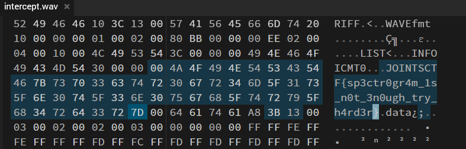
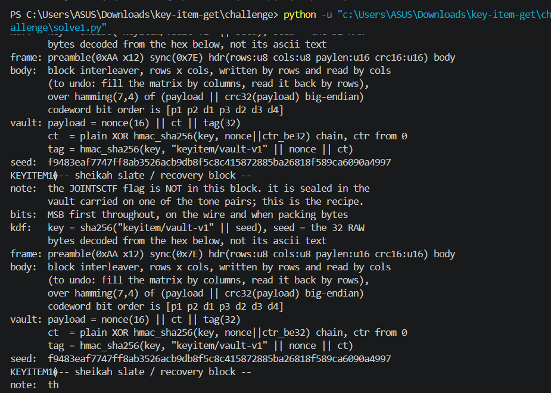
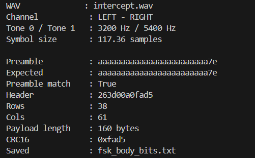
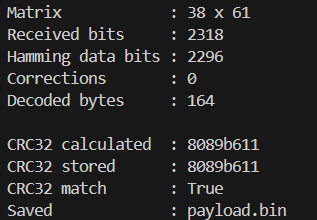
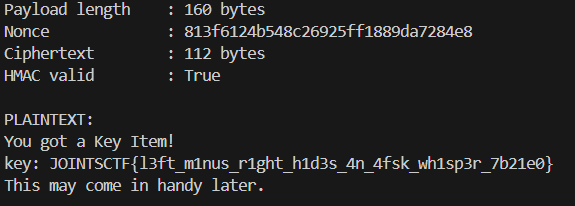

# Key Item Get

**Event:** JOINTS UGM CTF 2026 · **Category:** Forensics · **Team:** Otniellovevoli

### Challenge Description

> Item Kunci. Dengarkan. / A Key Item. Listen.

### Walkthrough

Jadi aku langsung melihat hex dari file intercept.wav dan membukanya di online hex editor,

Aku melihat ada sesuatu yang interesting : 



Tapi itu fake flag

Jadi aku melihat RIFF chunk (masi di hex editor), dan fake flagnya ada di WAV metadata bagian LIST/INFO/ICMT.

Jadi aku pindah dan memeriksa channels. Aku pisah bagian kiri dan kanan dan memeriksa sampel data menggunakan code python yang diberikan gemini

Hasil : 



gave the output to gemini, and it gave me a script to crack the seed with XOR or AES, tapi malah deadend

Aku kemudian membaca kembali isi recovery block yang ditemukan dari LSB. Ternyata di dalamnya sudah ada petunjuk untuk proses berikutnya, terutama bagian: 

```
frame: preamble(0xAA x12) sync(0x7E) hdr(...) body: block interleaver... over hamming(7,4)... vault: payload = nonce(16) || ct || tag(32)
```

Jadi aku tanyakan lagi ke Gemini apa maksud dari informasi tersebut dan apa yang harus dicari di file WAV. 

Gemini menjelaskan bahwa recovery block tersebut sebenarnya adalah semacam “petunjuk decoding”. Jadi seed bukan untuk langsung di-crack, tetapi nanti digunakan untuk membuat key setelah menemukan payload yang tersembunyi di audio.

Dari sini aku kembali melihat audionya, membuat spectrogram dan melihat ada beberapa frekuensi yang cukup menonjol. Karena filenya stereo, aku juga mencoba membandingkan channel kiri dan kanan



Dari hasil tersebut terlihat ada dua frekuensi yang cukup mencolok, sekitar 3200 Hz dan 5400 Hz. Aku memberikan hasil spectrogram tersebut ke Gemini dan bertanya apakah ini kemungkinan FSK.

Gemini menyarankan untuk mencoba mengambil perbedaan antara channel kiri dan kanan:

Kemudian sinyal tersebut dianalisis sebagai FSK, dimana satu frekuensi mewakili satu bit dan frekuensi lainnya mewakili bit yang lain.

Aku sempat salah di bagian timing symbol sehingga hasil decoding awalnya berupa data random dan tidak cocok dengan CRC. Setelah timing-nya diperbaiki, hasilnya mulai masuk akal.

Kemudian aku mencari pola yang diberikan oleh recovery block:

```
AA AA AA AA AA AA AA AA AA AA AA AA 7E
```

Pola tersebut berhasil ditemukan di awal stream.

Setelah bagian AAX12 dan 7E ditemukan, aku mengambil data setelahnya sebagai frame. Header yang didapat adalah: 26 3D 00 A0 FA D5. Kalau mengikuti format yang diberikan recovery block:

```
rows   = 0x26 = 38
cols   = 0x3D = 61
paylen = 0x00A0 = 160
crc16  = 0xFAD5
```

Selanjutnya terdapat data sebesar: 38 × 61 = 2318 bits

Recovery block mengatakan bahwa data tersebut harus di-deinterleave terlebih dahulu, kemudian di-decode menggunakan Hamming(7,4).

Aku kembali meminta Gemini membuatkan script untuk membalik proses tersebut.

Cara sederhananya adalah data dimasukkan ke matrix `38 × 61` berdasarkan kolom, lalu dibaca kembali berdasarkan baris. Setelah itu setiap 7 bit diproses menggunakan Hamming(7,4) untuk mendapatkan kembali 4 bit data.



Hasil decoding menghasilkan 164 byte. 160 byte pertama adalah payload dan 4 byte terakhir adalah CRC32. Aku kemudian mengecek CRC32 menggunakan Python:

```python
import zlib
print(zlib.crc32(payload).to_bytes(4, "big").hex())
```

Hasilnya:

```
8089b611
```

dan CRC yang ada di payload juga:

```
8089b611
```

Jadi bagian decoding audio sudah benar.

Setelah itu baru aku kembali ke bagian crypto yang sebelumnya sempat aku coba terlalu cepat. Setelah itu ciphertext di-XOR dengan HMAC-SHA256 keystream sesuai instruksi recovery block.

Hasil plaintext akhirnya:



```
Flag: JOINTSCTF{l3ft_m1nus_r1ght_h1d3s_4n_4fsk_wh1sp3r_7b21e0}
```

- **AI Link:** [https://share.gemini.google/ZcA1cNz5hZnG](https://share.gemini.google/ZcA1cNz5hZnG)

- **Solver:** [https://drive.google.com/file/d/15XaFpXLpjjYIFypQxDhfxfw7mx9iEDpi/view?usp=sharing](https://drive.google.com/file/d/15XaFpXLpjjYIFypQxDhfxfw7mx9iEDpi/view?usp=sharing)
