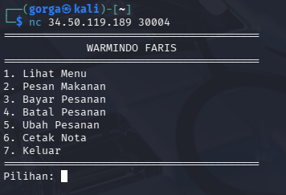
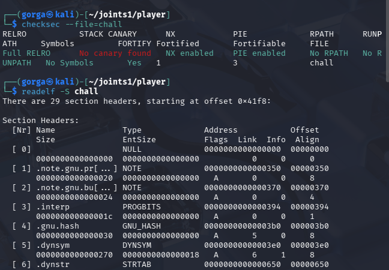
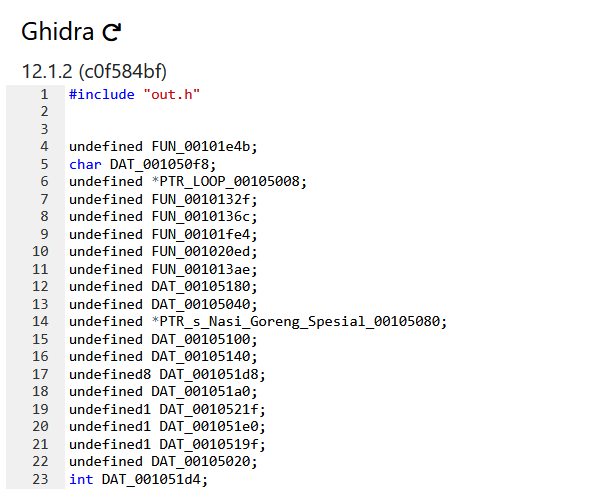
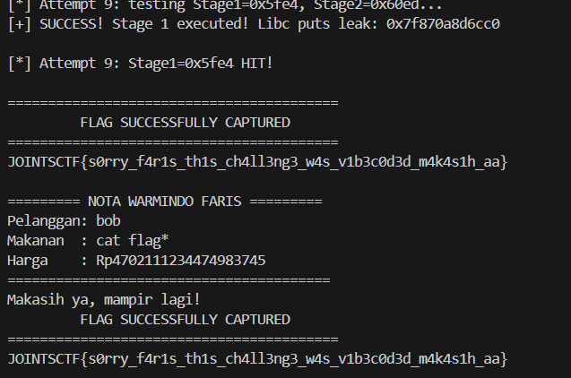

# burjo

**Event:** JOINTS UGM CTF 2026 · **Category:** Pwn · **Team:** Otniellovevoli

### Challenge Description

> pengen makan deh, gw samperin aa faris `nc 34.50.119.189 30004` burjo.zip

### Walkthrough

Jadi langsung aja download dan buka burjo.zip, lalu run nc 34.50.119.189 30004 di linux, dan ditunjukkan menu warmindo faris



aku coba2 opsinya, tapi tidak ada yang interesting.

Daripada nebak-nebak liar, aku minta roadmap awal analisis binary pwn ke Gemini, sekaligus tanya arti output mitigasi proteksi (checksec).

Gemini menyarankan untuk cek mitigasi dengan checksec, intip string dengan strings, dan lihat section ELF dengan readelf. Langsung aku jalankan pengecekan dasar di terminal:



Hasil pemeriksaan menunjukkan bahwa biner ini berupa berkas 64-bit ELF dengan skema proteksi yang aktif meliputi PIE, NX, dan Partial RELRO, namun tanpa perlindungan Stack Canary. Di samping section standar ELF seperti .text atau .rodata, ditemukan sebuah section khusus yang tidak biasa bernama .stage. Mengenai impor simbolnya, biner ini tidak mengimpor system@plt secara langsung, melainkan memanfaatkan fungsi dlsym dan dladdr. Selain itu, pada section .rodata terdeteksi beberapa string menarik, yaitu "system", "puts", "libc", serta pesan status "Callback belum siap untuk tahap ini." dan "Sistem belum siap. Coba lagi nanti.".

Melihat keanehan ini, aku balik tanya lagi ke Gemini: "Kenapa binary pakai dlsym & dladdr? Terus ada section custom .stage sama string 'system' di rodata, ini maksudnya apa ya?"

Gemini bilang: dlsym dipakai untuk mencari alamat fungsi secara dinamis saat runtime berdasarkan nama teks (misal mencari "system" atau "puts"), bukan lewat linking standar.

Section .stage kemungkinan besar disiapkan sebagai fungsi panggung bertahap (multi-stage execution).

Karena penasaran sama section .stage, aku decompile binary chall di Ghidra. Di dalam section .stage tersebut, aku menemukan dua fungsi khusus yang tidak pernah dipanggil di alur menu biasa(make ghidra online loh yah):



paste to gemini, dan dibilang Artinya skenario soal ini sudah kelihatan: pembuat soal menyediakan Stage1 untuk kita bocorkan (leak) alamat libc, lalu meloncat ke Stage2 untuk mengeksekusi shell command lewat system().

Sini aku agak stuck dan lihat kembali opsi3. Hasil pemeriksaan struktur data pesanan menunjukkan bahwa field nomor telepon (phone) dimulai pada offset 0x40, sementara pointer fungsi callback1 terletak pada offset 0x70, yang berarti terdapat jarak selisih sebesar 0x30 atau 48 byte di antara keduanya. Ketika kondisi flags[idx] == 1 terpenuhi, input untuk nomor telepon diizinkan hingga mencapai 144 byte, sehingga input yang melebihi batas 48 byte tersebut akan langsung menimpa pointer callback1. Hal ini berlanjut saat pengguna memilih Opsi 6 (Cetak Nota Pembayaran), di mana program akan mengeksekusi pointer callback1(order). Dengan demikian, jika callback1 berhasil ditimpa melalui kelebihan input tersebut, alur eksekusi dapat diarahkan untuk melompat ke fungsi mana pun yang diinginkan.

Agar kondisi overflow dapat diaktifkan, variabel flags[idx] perlu bernilai 1. Berdasarkan penelusuran, pengubahan nilai variabel ini terjadi pada Opsi 5 (Ubah Catatan Pesanan), di mana flags[idx] hanya akan diset ke nilai 1 jika nama makanan pada pesanan cocok secara tepat dengan string voucher global yang tersimpan di memori (0x51e0). String pada voucher global tersebut diisi saat menjalankan Opsi 4 (Batalkan Pesanan), yang bertugas menyalin nama makanan dari pesanan yang dibatalkan ke dalam voucher. Skenarionya dimulai dengan membuat pesanan pertama (misalnya atas nama Alice) menggunakan menu "cat flag*", kemudian membatalkan pesanan tersebut melalui Opsi 4 agar string "cat flag*" tersimpan di voucher global. Langkah berikutnya adalah membuat pesanan kedua (misalnya atas nama Bob) dengan menu yang sama, lalu mengedit catatan pesanan Bob melalui Opsi 5. Karena menu Bob cocok dengan isi voucher, program akan secara otomatis mengeset flags[bob] = 1, yang memberikan izin input hingga 144 byte pada menu pembayaran untuk pesanan Bob. Keuntungan tambahan dari alur ini adalah ketika tahap selanjutnya memanggil fungsi system(order), argumen pertama yang diproses sudah langsung berupa perintah "cat flag*".

Masalahnya, proteksi PIE aktif, jadi alamat memori binary selalu diacak setiap kali dijalankan. Aku tanya lagi ke Gemini soal strategi menghadapi PIE jika kita hanya bisa menimpa 2 byte pointer.

Penjelasannya menunjukkan bahwa alamat fungsi Stage1 berada pada offset 0x1fe4, di mana tiga digit hex terbawah (0xfe4 atau 12 bit) memiliki posisi konstan karena terikat oleh batas page memory sebesar 4 KB. Oleh karena itu, bagian yang diacak oleh ASLR pada 2 byte terbawah hanya tersisa 1 digit hex di atasnya (4 bit), yaitu variasi dari 0x1fe4, 0x2fe4, hingga 0xffe4, yang membuat total kemungkinannya hanya ada 16 variasi. Proses eksploitasi dapat dilakukan melalui metode bruteforce sederhana, yaitu dengan mengirimkan padding sebanyak 48 byte diikuti oleh 2 byte tebakan low-16 bit dari Stage1, kemudian memanggil menu Cetak Nota (Opsi 6). Jika tebakan tersebut benar, Stage1 akan langsung merespons dengan membalas 8 raw bytes yang berisi bocoran alamat puts, sedangkan jika tebakan salah, koneksi baru dapat dibuat untuk mencoba digit hex berikutnya yang rata-rata akan berhasil dalam 8 hingga 16 kali percobaan.

Setelah Stage1 berhasil aktif dan membocorkan 8 byte alamat puts, posisi memori biner saat itu dapat diketahui secara pasti. Hal ini dimungkinkan karena selisih jarak offset antara Stage1 (0x1fe4) dan Stage2 (0x20ed) bersifat tetap, yaitu sebesar +0x109 (Δ=0x20ed−0x1fe4). Masih di koneksi yang sama, langkah berikutnya adalah melakukan pembayaran ulang untuk pesanan Bob melalui Opsi 3 guna menimpa pointer callback1 dengan alamat Stage2. Ketika menu Cetak Nota (Opsi 6) dipanggil kembali, Stage2 akan aktif dan secara otomatis mengeksekusi perintah system("cat flag*").

Hasil : 



```
Flag: JOINTSCTF{s0rry_f4r1s_th1s_ch4ll3ng3_w4s_v1b3c0d3d_m4k4s1h_aa}
```

- **AI Link:** [https://share.gemini.google/Lo7pRVgTw9Cw](https://share.gemini.google/Lo7pRVgTw9Cw)

- **Solver:** [https://drive.google.com/file/d/1qe7t8NRGrF05izWRxqM7ZNi3tAQaw9Jq/view?usp=sharing](https://drive.google.com/file/d/1qe7t8NRGrF05izWRxqM7ZNi3tAQaw9Jq/view?usp=sharing)
