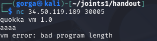
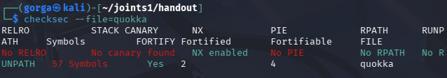

# quokka

**Event:** JOINTS UGM CTF 2026 · **Category:** Pwn · **Team:** Otniellovevoli

### Challenge Description

> A cute little stack VM that is very careful about types. Well, almost. `nc 34.50.119.189 30005` quokka.zip

### Walkthrough

download quokka dan coba nc



Dari hasil image tersebut, kita tahu service remote berjalan dengan baik dan menampilkan banner quokka vm 1.0. Kita periksa proteksi file biner quokka


Hasil menunjukkan tidak ada PIE, RELRO, or Canary. Karena No PIE dan No RELRO, lokasi GOT table seperti got.puts (0x403798) dan got.fflush (0x4037c0) berada di alamat pasti dan bisa kita overwrite secara langsung jika mendapatkan arbitrary write primitive.

Setelah melakukan reverse-engineering dengan bantuan AI untuk memahami struktur VM dan opcodenya, kita mendapatkan gambaran alur kerja objek di dalamnya: 

Buffer dialokasikan di heap dengan header yang menyimpan informasi type, len (panjang), dan data_ptr.

Dari sini, vuln Utama adalah bug fatal ditemukan pada handler opcode ACOPY (0x17). From gemini : Ketika program menyalin data dari src ke dst, dilakukan pengecekan awal untuk memastikan apakah dst->len >= len. Namun, terjadi ketidaksesuaian karena nilai len pada tipe Buffer dihitung dalam satuan byte, sementara pemanggilan fungsi memcpy justru mengalikan ukuran tersebut sebanyak delapan kali (len * 8). Hal ini menyebabkan bahaya keamanan: sebagai contoh, ketika menyalin buffer berukuran 32 byte dengan len = 32, pengecekan kapasitas tetap lolos, tetapi memcpy secara tidak sengaja menyalin hingga 256 byte. Akibatnya, timbul celah kerentanan Heap Buffer Overflow sebesar 8 kali lipat yang memungkinkan akses melebihi batas buffer untuk memeriksa atau memodifikasi isi header objek di sekitarnya.

Jadi Karena ASLR aktif di server remote, alamat library libc akan acak di setiap eksekusi. Oleh karena itu, kita membuat strategi 2-Pass.

Proses eksploitasi dilakukan dalam dua tahap utama untuk meretas alur eksekusi program. Pada tahap pertama, tujuannya adalah bocornya (leak) alamat memori libc dan mengembalikan eksekusi kembali ke fungsi main. Tahapan ini dimulai dengan mengalokasikan tiga buah buffer secara berurutan di dalam heap, yaitu buf1, buf2, dan src_buf. Kerentanan overflow dari instruksi ACOPY pada src_buf kemudian dimanfaatkan untuk melompati buf1 dan menimpa header dari buf2, sehingga penunjuk data (data_ptr) milik buf2 berubah mengarah ke alamat got.puts. Selanjutnya, instruksi BSETW digunakan untuk menimpa entri GOT fungsi fflush dengan alamat fungsi main (0x401376). Ketika fungsi PRINT(buf2) dipanggil, program akan mencetak isi dari got.puts yang membocorkan alamat runtime fungsi puts di libc. Sesaat setelah itu, program memanggil fflush, tetapi karena entri GOT fflush telah diubah menuju main, mesin virtual (VM) tidak akan berhenti (exit), melainkan melakukan pemulaian ulang (restart) kembali ke fungsi main untuk bersiap menerima instruksi kedua.

Pada tahap kedua, dilakukan pembajakan tabel GOT (GOT hijack) agar mengarah ke fungsi system("/bin/sh"). Berdasarkan alamat leak puts yang diperoleh dari tahap pertama, alamat dasar (base address) dari libc serta posisi fungsi system() dapat dihitung dengan presisi. Muatan instruksi (bytecode payload) kedua kemudian dikirimkan menggunakan buf2 untuk menimpa entri GOT fungsi puts (0x403798) dengan alamat fungsi system(). Setelah itu, dibuat sebuah buffer baru yang dikondisikan berisi string "/bin/sh\x00". Ketika fungsi PRINT dipanggil pada buffer string tersebut, program yang seharusnya mengeksekusi panggilan puts(buffer) secara otomatis mengeksekusi fungsi system("/bin/sh") karena alur entri GOT telah dibajak.

buat script, run it, got the flag.

```
Flag: JOINTSCTF{qu0kka_c0pi3d_w1th0ut_ch3ck1ng_1ts_typ3s_h3h3}
```

- **AI Link:** [https://share.gemini.google/UREbvCCv4RG6](https://share.gemini.google/UREbvCCv4RG6)

- **Solver:** [https://drive.google.com/file/d/1XZ-AT8ONXokgQNdWS1ZaxfpJGVN03j9U/view?usp=sharing](https://drive.google.com/file/d/1XZ-AT8ONXokgQNdWS1ZaxfpJGVN03j9U/view?usp=sharing)
