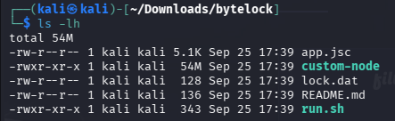
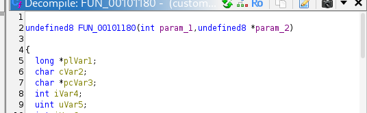

# ByteLock

**Event:** JOINTS UGM CTF 2026 · **Category:** Reverse · **Team:** Otniellovevoli

### Challenge Description

> The bytecode is locked, but the machine that runs it is right here. `nc 34.50.119.189 30006`

### Walkthrough

Coba koneksi ke nc-nya dan diminta secret word. Jika salah input akan keluar tulisan ACCESS DENIED. Pada attachmentnya, ada beberapa file yang ketika dicek dengan ls -lh:



Kalo dicek dengan command file, jsc ini adalah V8 Bytecode Cache. Ketika dijalanin bytecode ini kekunci oleh secret word (ceritanya sesuai dengan hint pada challange desc). Saya cek dengan strings dan grep ACCESS DENIED pada setiap file, ketemu kalo ACCESS DENIED ada di custom-node. 

Karena ini soal reverse, filenya dimasukin ke Ghidra. Terus kita cari string ACCESS DENIED terus kita trace back pake xref ke fungsi main di mana string tadi akan diprint. Setelah trace back dua kali ke atas, ketemu fungsi mainnya.



Kita ganti namanya jadi main dan parameternya jadi argc dan argv biar mirip pseudo C.

```
Flag: JOINTSCTF{V8_3NG1N3_5RUTUTUTUTUTUTUTUTUTUT}
```

- **AI Link:** [https://share.gemini.google/UwjTM2KIkZBq](https://share.gemini.google/UwjTM2KIkZBq)
