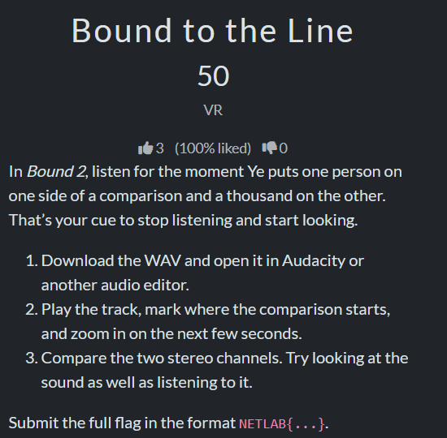
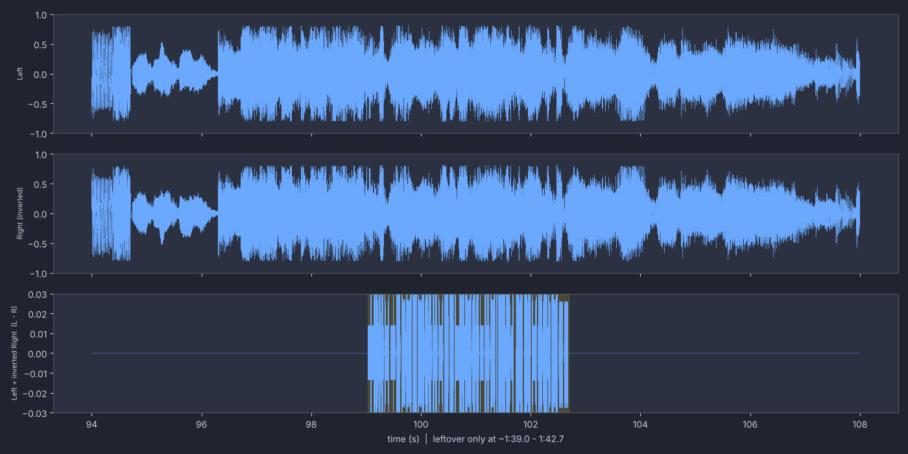
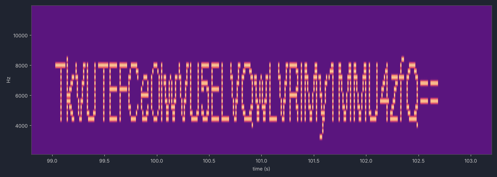
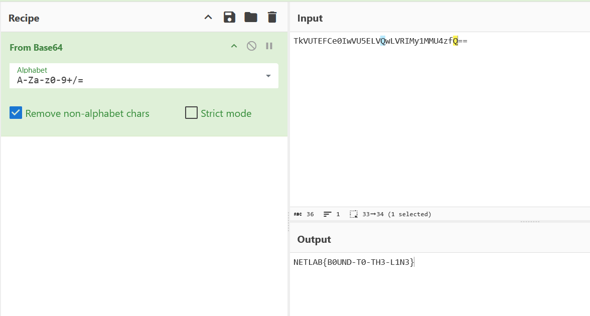

# Bound to the Line

**Event:** NETLAB CTF · **Category:** Forensics

### Challenge Description



### Walkthrough

The description says to listen for the moment ye compares one person to a thousand, so i just opened the wav in audacity and played it until i heard "one good girl is worth a thousand bitches". that line is at around 1:36 - 1:45, so that's my cue to stop listening and start looking.

Now the channels. i click the track name and choose Split Stereo Track so left and right are separate tracks. they look the same at first. then i select the right one and do Effect > Invert, and play both together. if the channels were really identical they would cancel out to silence, but there is still a quiet buzz between about 1:39 and 1:42. so left and right are different only in that spot.
(i checked this part with python instead of audacity because it was faster, same idea, L - R. correlation between the two channels is 0.9999 and the difference is only about 1.5% of the song's loudness, and it is exactly zero everywhere except 1:39.0 - 1:42.7)



Next is the spectrogram. i select both tracks and do Tracks > Mix > Mix and Render so i get one track that is just L - R. it's super quiet so i run Effect > Normalize on it. then i click the track name and change the view to Spectrogram. in Spectrogram Settings i set the window size to 1024 and max frequency to 12000 Hz, then zoom in on the 3.7 seconds of sound.
and there it is, blocky letters drawn between around 4 kHz and 8.5 kHz. the buzz is literally a picture of text.



it reads : TkVUTEFCe0IwVU5ELVQwLVRIMy1MMU4zfQ==

the == at the end is base64 padding, and the start TkVUTEFC decodes to NETLAB, which is the flag format, so i knew this was it.
some letters were confusing in this blocky font :
• the 0 after e looks like a capital O. base64 for NETLAB{ is TkVUTEFCew... and the next char has to be a digit for the text to be readable, so it's a zero
• the I after it could also be a lowercase l. i tried both and decoded each one, only I gives readable text (B0UND), l gives garbage like IpUND
so when a letter is unclear, just try every option and decode, only one will make sense.
Last step is decoding. i put the string in cyberchef with From Base64 and got the flag


### Flag

```
NETLAB{B0UND-T0-TH3-L1N3}
```
