# Janus Lattice: Split Verdict

**Event:** NETLAB CTF · **Category:** Forensics

### Challenge Description

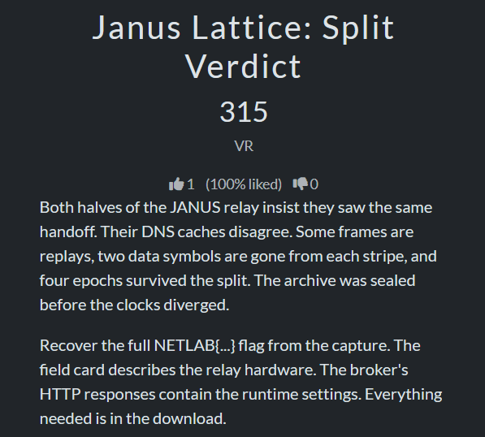

### Walkthrough

folder structure : 
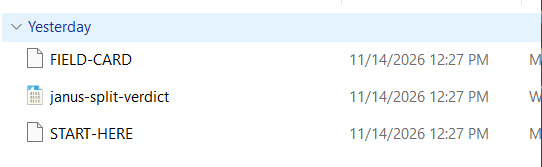

START-HERE : 
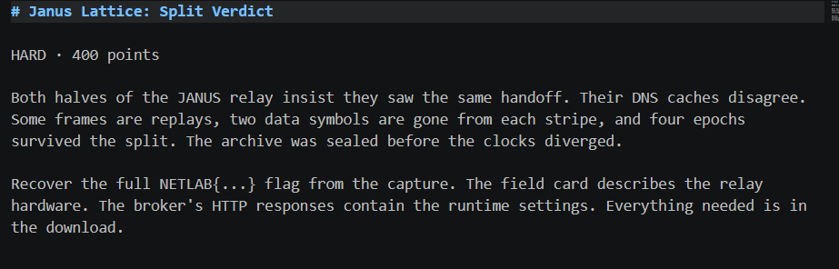

FIELD-CARD : 
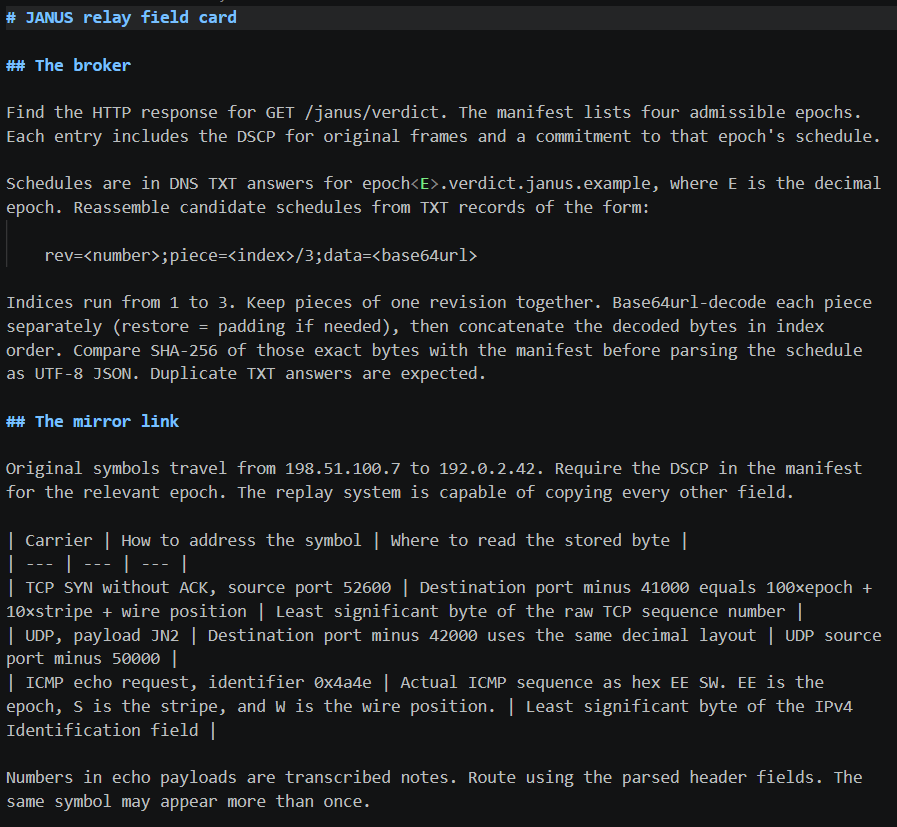
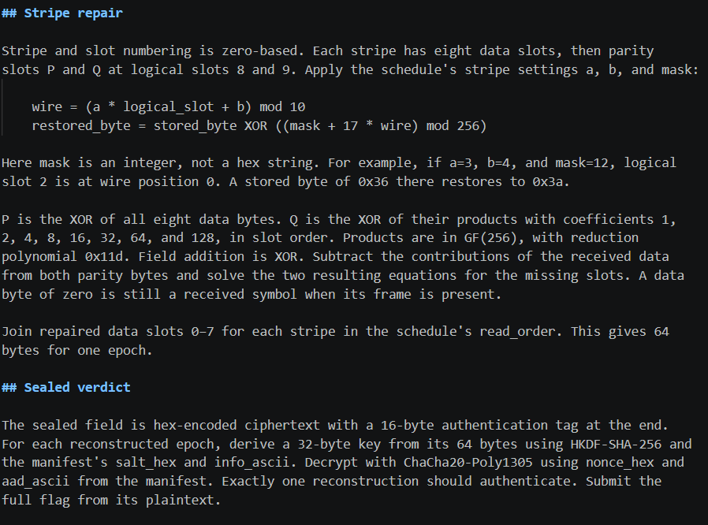

Field card says to find GET /janus/verdict, so i use this filter
http.request.uri contains "verdict"
result : 
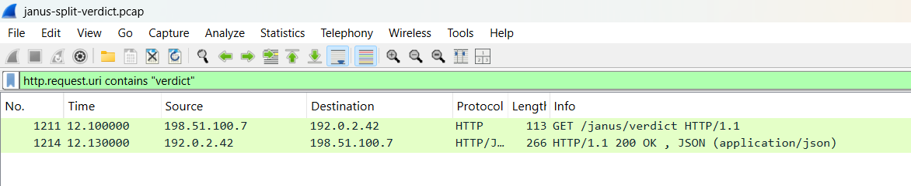

Then i opened the HTTP Stream of the first packet
result : 
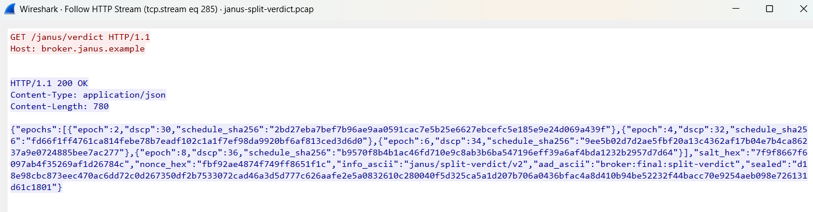

The response is split into 3 tcp segments but follow stream puts it together. The JSON has 4 epochs (2, 4, 6, 8) with a dscp and a schedule_sha256 each. Epoch 2 is dscp 30, 4 is 32, 6 is 34 and 8 is 36. It also has salt_hex, nonce_hex, info_ascii, aad_ascii and the sealed hex blob. I save all of this because i need it at the end.

Now the schedules. The card says they are in DNS TXT answers for epoch<E>.verdict.janus.example, so i use this filter : 
rev=3;piece=1/3;data=eyJyZWFkX29yZGVy...
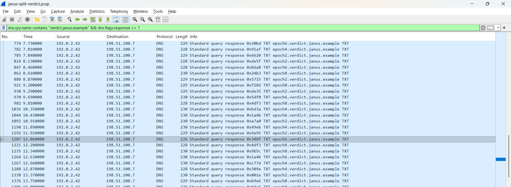

There are also a ton of mirror-NNN.janus.example answers that say monitor=heartbeat. Decoy again, the filter above already removes them. What is left looks like this : 
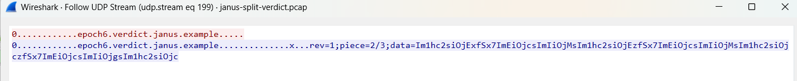

So each epoch has 3 revisions (rev) and every revision has 3 pieces. Some records also repeat, but the card says duplicates are expected. To read them faster i add dns.txt as a column (right click the field → Apply as Column)

The trick is clear here, only one revision per epoch is the real one. The card says to base64url decode each piece separately (add the = padding back), join the bytes in piece order and compare the sha256 with the manifest before parsing. i do this in cyberchef for one piece to see what it looks like, it decodes to json starting with {"read_order":[.... After hashing every combination, only one rev matches per epoch. Wrong revisions are still valid looking json so the hash is the only way to tell.
Result : epoch 2 = rev 3, epoch 4 = rev 2, epoch 6 = rev 1, epoch 8 = rev 1.
Each schedule has a read_order and 8 stripes, and every stripe has a, b and mask.
Next is the symbols. The card says the original symbols go from 198.51.100.7 to 192.0.2.42 and must have the dscp from the manifest. This is the replay trap, because the replays copy every other field but not dscp. In wireshark the field is ip.dsfield.dscp. So for epoch 8 (dscp 36) the 3 filters are : 
- ip.src==198.51.100.7 && tcp.srcport==52600 && tcp.flags.syn==1 && tcp.flags.ack==0 && ip.dsfield.dscp==36
- ip.src==198.51.100.7 && udp contains "JN2" && ip.dsfield.dscp==36
- ip.src==198.51.100.7 && icmp.type==8 && icmp.ident==0x4a4e && ip.dsfield.dscp==36

After this, it took a while so i'll just explain my logic : 
For every packet i read the position and the stored byte from the table in the field card.
• TCP : tcp.dstport - 41000 = 100*epoch + 10*stripe + wire, and the byte is the low byte of the raw tcp sequence number. Wireshark shows relative seq by default so i turn that off or use tcp.seq_raw.
• UDP : udp.dstport - 42000 is the same layout, and the byte is udp.srcport - 50000.
• ICMP : the sequence is hex EE SW, so epoch is the top byte, stripe is the high nibble of the low byte and wire is the low nibble. The byte is the low byte of ip.id.    

The icmp payload has numbers in it but the card says those are just transcribed notes, so i only use the header fields.
After collecting everything for all 4 epochs i get 256 symbols and no conflicts between carriers (same symbol can show up more than once, but they always have the same byte). This is where doing it by hand gets annoying so i script it.
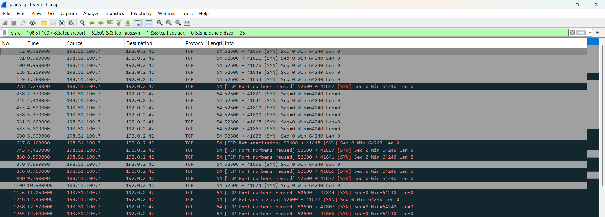

Now the stripe repair. Every stripe has 10 slots, 8 data slots (0 to 7) and then parity P and Q at logical slots 8 and 9. For each logical slot
wire = (a * logical_slot + b) mod 10
restored_byte = stored_byte XOR ((mask + 17 * wire) mod 256)
So i go through slot 0 to 9, find which wire position it sits on, grab the symbol and un-mask it. Two data slots are always missing in each stripe. The card says a data byte of zero still counts as received if its frame is present, so missing means no frame at all.
To get the 2 missing bytes (call them slot i and slot j) i use the parity. First remove the received data from both parity bytes
• sP = P xor (all received data bytes)
• sQ = Q xor (each received data byte times its coefficient 1,2,4,...,128 in GF(256), poly 0x11d)
then i have two equations, xi ^ xj = sP and ci*xi ^ cj*xj = sQ. Solving gives xj = (sQ ^ ci*sP) / (ci ^ cj) and then xi = sP ^ xj. Join data slots 0 to 7 of each stripe following read_order and that is 64 bytes per epoch.
Last step is decrypting. For each epoch, key = HKDF-SHA256 over the 64 bytes with the salt_hex and info_ascii from the manifest (32 bytes out), then ChaCha20-Poly1305 with nonce_hex and aad_ascii. The card says exactly one reconstruction should authenticate, so there is nothing to guess. 3 epochs fail the tag and epoch 8 works

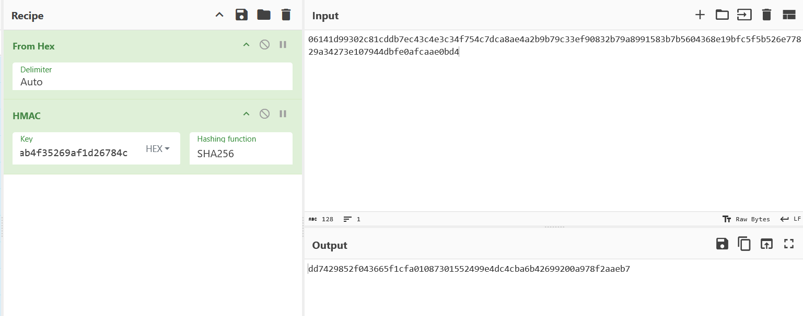

flag : 
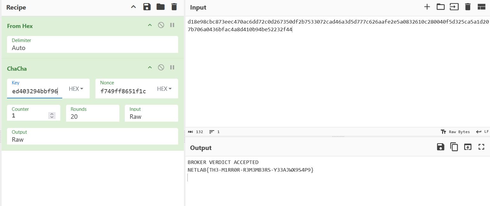

### Flag

```
NETLAB{TH3-M1RR0R-R3M3MB3RS-Y33AJWX9S4P9}
```
