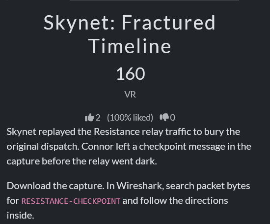
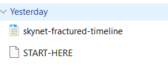
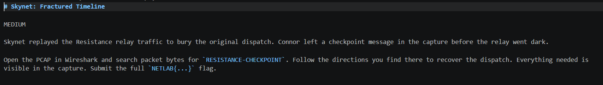
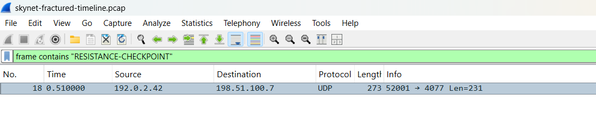
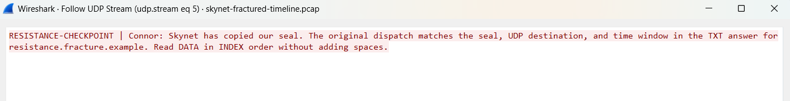
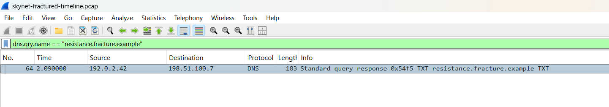
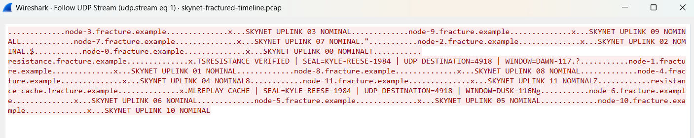
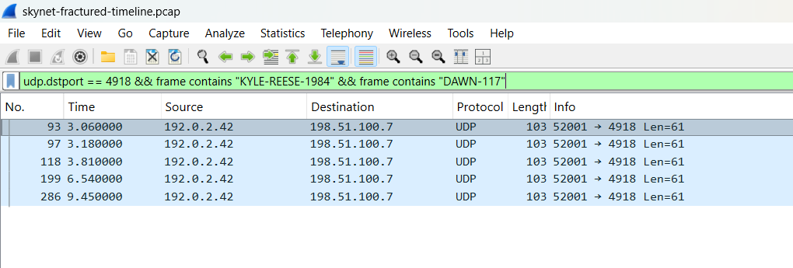

# Skynet: Fractured Timeline

**Event:** NETLAB CTF · **Category:** Forensics

### Challenge Description



### Walkthrough

Folder structure : 


START-HERE : 


First i search the packet bytes. In the display filter bar i put :
• frame contains "RESISTANCE-CHECKPOINT"

result : 


following the udp stream : 

Basically Connor says skynet copied the seal, so there are fake dispatches in the capture. The real one has to match the seal, UDP destination and time window from the TXT answer for resistance.fracture.example. Then read DATA in INDEX order without spaces.
Next is the TXT answer. I us this filter :
• dns.qry.name == "resistance.fracture.example"


read the udp stream again : 


From here, we know the real value is : 
• SEAL = KYLE-REESE-1984
• UDP DESTINATION = 4918
• WINDOW = DAWN-117

This is the first trap. There is another TXT record for resistance-cache.fracture.example with the same seal and port but WINDOW=DUSK-116. If you search for "fracture" you will see both, i used the exact name with == so only the real one shows.

Now the dispatch packets. I use all three values in one filter :
• udp.dstport == 4918 && frame contains "KYLE-REESE-1984" && frame contains "DAWN-117"


5 packets left (93, 97, 118, 199, 286). Each payload looks like SEAL=... WINDOW=... INDEX=n/5 DATA=.... I clicked each one and read the payload in the packet bytes.

The fake ones use the same format but break one thing : seal is KYLE-REESE-1985, window is DUSK-116, or the destination port is 4919. The 4919 ones are the sneaky ones, seal and window are correct so you only catch them if you check the port. Also the fake DATA looks like hex (like 5ceae041) while the real DATA is readable text, so that is a nice sanity check.
Last step is joining. The packets are shuffled so sort by INDEX, not by packet number :
• 1/5 : NETLAB{SK (packet 286)
• 2/5 : 3NET-R3WR (packet 97)
• 3/5 : 0TE-T0M0R (packet 199)
• 4/5 : R0W-S68B5 (packet 93)
• 5/5 : H-AQDDQZ} (packet 118)

Join without adding spaces will give me : 
NETLAB{SK3NET-R3WR0TE-T0M0RR0W-S68B5H-AQDDQZ}

### Flag

```
NETLAB{SK3NET-R3WR0TE-T0M0RR0W-S68B5H-AQDDQZ}
```
