# Who Wore the Mask?

**Event:** NETLAB CTF · **Category:** Forensics

### Walkthrough

Folder Structure:
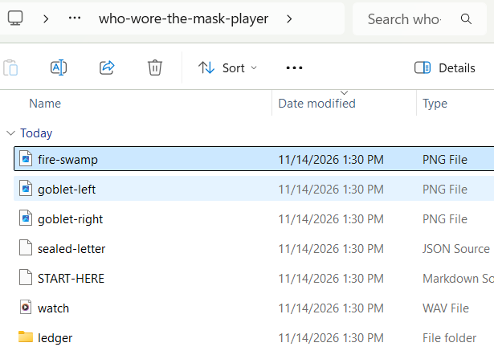

Opening the .md file titled start-here gave me this :
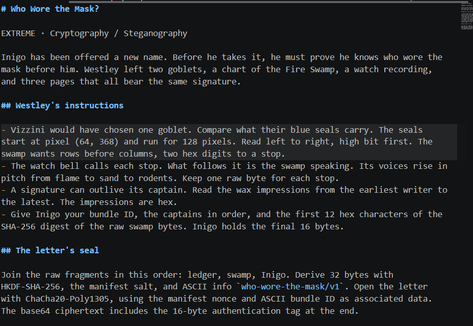

so my goal right now is just finding bundle ID, captain order, and rendezvous code.
After searching arond the given files, i found the bundle ID just sitting in the file sealed-letter.json : 
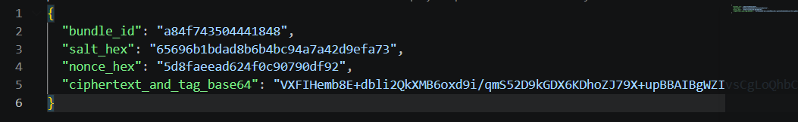

next i went to the ledger folder and new all the files there correlated with one another.
after reading 3 files in ledger folder, i figured out the captain order.
page-harbor.txt (“Ryan … will take my place”) was written by Cummerbund, the earliest captain, handing the name to Ryan.
page-payroll.txt (“I took the name from Cummerbund”) was written by Ryan.
page-mask.txt (“Ryan left me his ship”) was written by Westley, the latest captain.
So,the order from earliest to latest is Cummerbund, Ryan, Westley.

Next is rendezvous code. This took me awhile so i'll just get straight to how i found it.
This is the first 12 hex characters of the SHA-256 of the swamp bytes, so i build those bytes first.
I opened both goblet PNGs
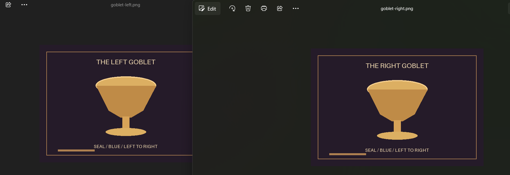

For each goblet i read the blue value of 128 pixels, starting at (64, 368) and going right along the row. Take the lowest bit of each. Then i pack those 128 bits into 16 bytes, first bit as the high bit (used gpt for this) : 
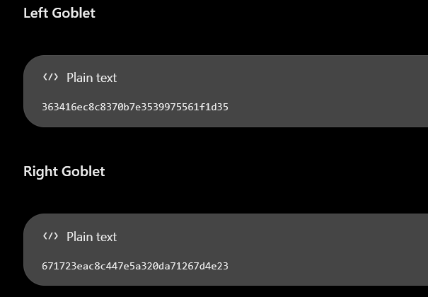
Then i XOR the two goblets 16 bytes. The result is : 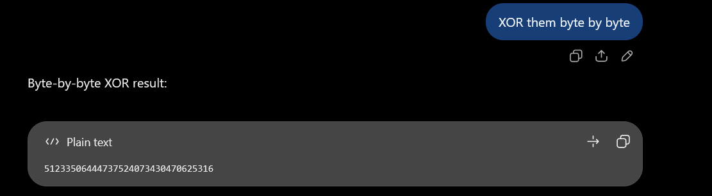

note : from "Vizzini would have chosen one goblet. Compare what their blue seals carry.” I took “compare” to mean XOR, which is my interpretation.

Read that as 16 pairs of hex digits. Each pair is a stop, with the row first and the column second.

Next, i listened to watch.wav and knew from the start-here instuction that i needed to get the voice for each stop from the watch.
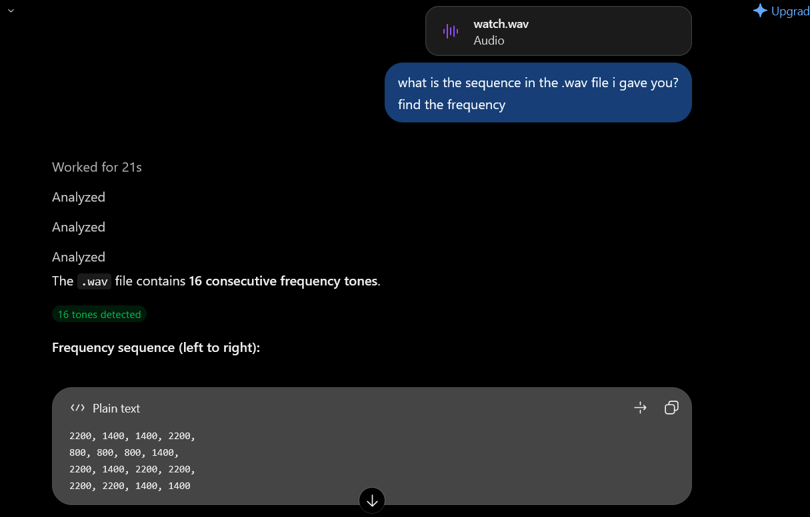
from the earlier instruction, it seems that 800 Hz is flame, 1400 Hz is sand and 2200 Hz is rodents. This will be important later

Then following Wesley's instuction, I build the swamp bytes.
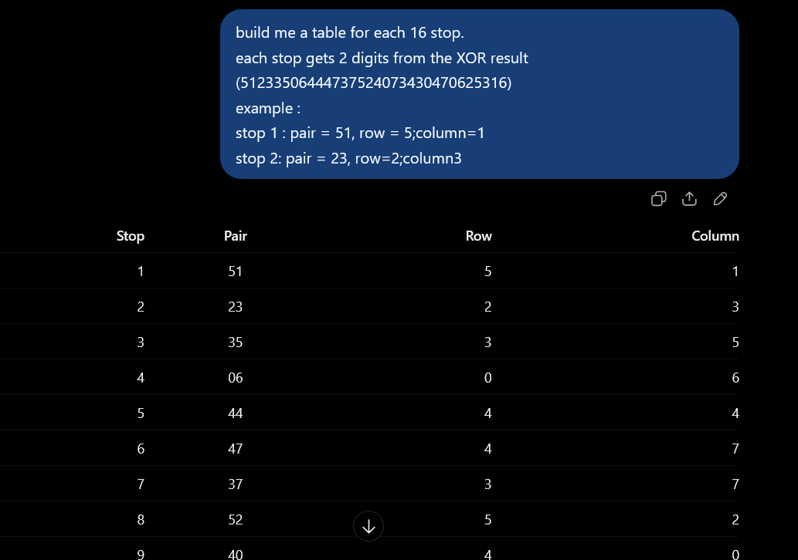

For stop i, go to that row and column in the swamp chart in file fire-swamp.png
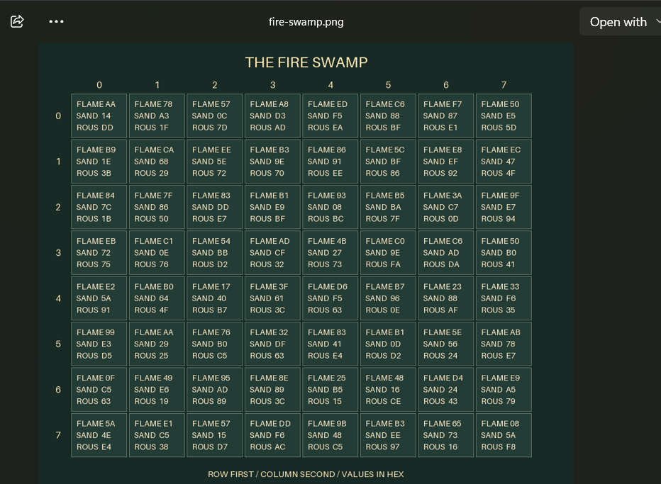

Take the value for voice i (the FLAME, SAND or ROUS line) and keep it as one raw byte.
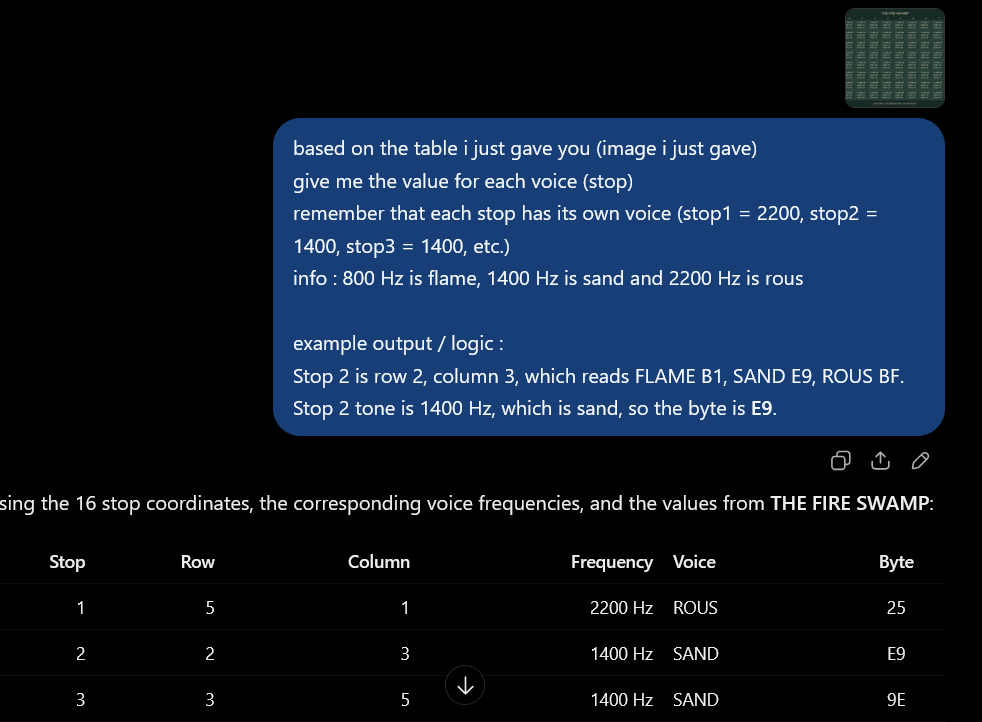

Joined together, the 16 bytes are : 
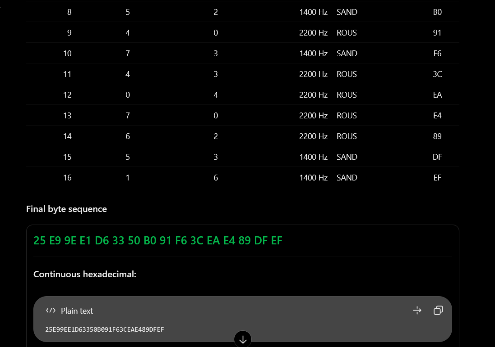
25E99EE1D63350B091F63CEAE489DFEF

Then from the last instruction of start-here, compute the SHA-256 and keep the first 12 hex characters: 
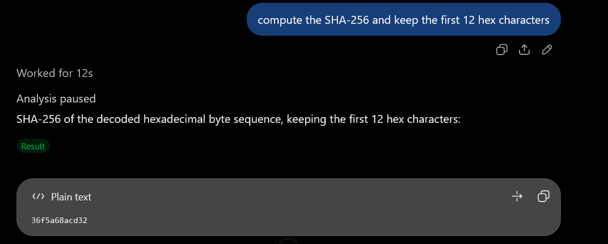
36f5a68acd32

Result : 
Bundle ID: a84f743504441848
Captain order: Cummerbund, Ryan, Westley
Rendezvous code: 36f5a68acd32

giving it to the administrator gave me : 
fb60e492ba5d90e4ebede6052ab50118

It looks like the 16 bytes of key material from Inigo that is used to decrypt is the ciphertext in sealed-letter.json : 

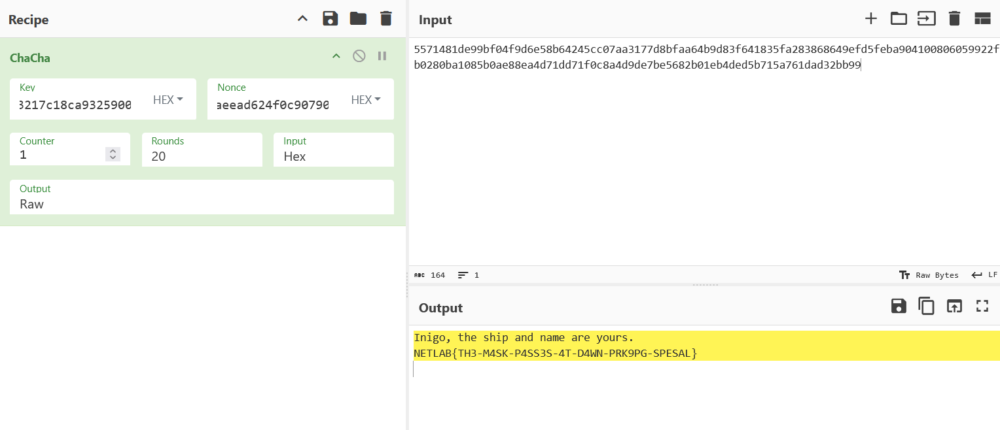

brief explanation of each section : 
In the input box : this is the encrypted letter with the last 16 bytes removed. Those 16 bytes are the Poly1305 authentication tag, which is a checksum and not encrypted text, so decrypting them would add junk to the end

Key (ce6986…7554): the 32-byte key from HKDF-SHA-256

Nonce (5d8faeead624f0c90790df92): copied from nonce_hex in sealed-letter.json

Counter = 1: ChaCha20-Poly1305 uses block 0 to make the one-time Poly1305 key. The message encryption starts at block 1, so starting at 0 gives the wrong output.

Rounds20 cause were using ChaCha20

Flag : NETLAB{TH3-M4SK-P4SS3S-4T-D4WN-PRK9PG-SPESAL}

AI Chat used : https://chatgpt.com/share/6af813cf-e1b0-83ec-8d4e-5e989ea3132a

### Flag

```
NETLAB{TH3-M4SK-P4SS3S-4T-D4WN-PRK9PG-SPESAL}
```
