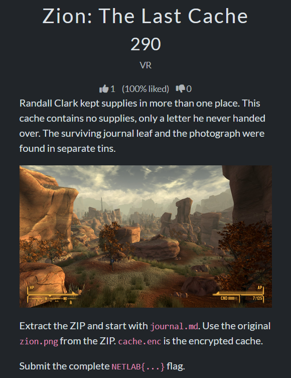
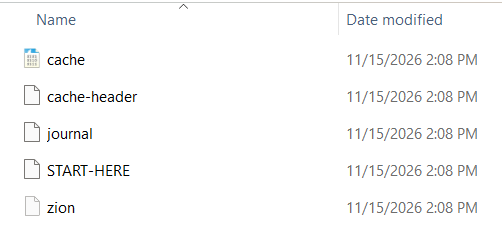
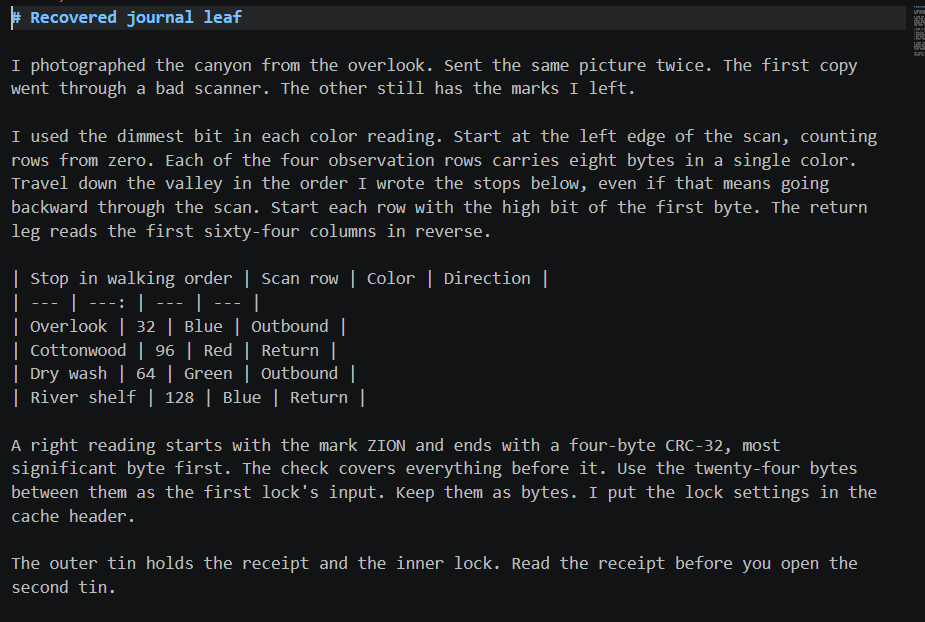
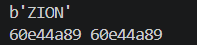
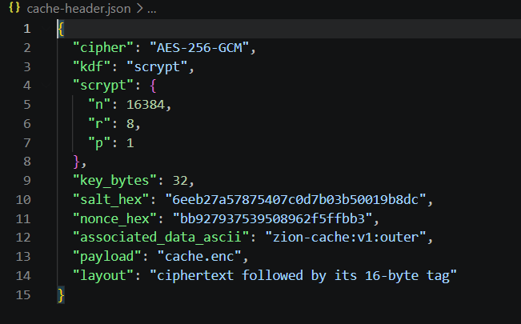
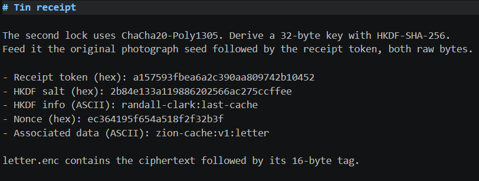
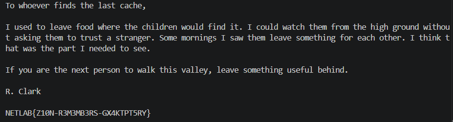

# Zion: The Last Cache

**Event:** NETLAB CTF · **Category:** Forensics

### Challenge Description



### Walkthrough

Zip folder structure : 


Starting with journal.md : 


from the instruction in journal.md, i extracted the bits from the image using a py script.
```python
import zlib
from PIL import Image

im = Image.open("zion.png").convert("RGB")
# (row, channel R=0 G=1 B=2, reversed?)
stops = [(32, 2, False), (96, 0, True), (64, 1, False), (128, 2, True)]

out = b""
for row, ch, rev in stops:
    cols = list(range(64))
    if rev:
        cols = cols[::-1]
    bits = [im.getpixel((c, row))[ch] & 1 for c in cols]
    out += bytes(int("".join(map(str, bits[i:i+8])), 2) for i in range(0, 64, 8))

print(out[:4])
print(zlib.crc32(out[:-4]).to_bytes(4, "big").hex(), out[-4:].hex())
seed = out[4:28]
```

for every stop i take the first 64 pixels of that row, take the chosen channel & 1, reverse the list if it's a Return row, then pack 8 bits per byte.
output : 


note : if the CRC didn't match i would have tried the other bit order (LSB first) or flipped which rows are reversed, but i got it right the first time.

Next i looked at cache-header.json : 


so it's already telling me everything, the only missing thing was the password, and that is the seed from the image. i derived the key with scrypt and decrypted with AES-GCM
```python
import hashlib
import json
import zlib
from pathlib import Path

from cryptography.hazmat.primitives.ciphers.aead import AESGCM
from PIL import Image

base_dir = Path(__file__).resolve().parent
with (base_dir / "cache-header.json").open(encoding="utf-8") as header_file:
    header = json.load(header_file)

stops = [(32, 2, False), (96, 0, True), (64, 1, False), (128, 2, True)]
with Image.open(base_dir / "zion.png") as image_file:
    image = image_file.convert("RGB")

stream = bytearray()
for row, channel, reverse in stops:
    columns = range(63, -1, -1) if reverse else range(64)
    bits = [image.getpixel((column, row))[channel] & 1 for column in columns]
    stream.extend(
        int("".join(map(str, bits[index:index + 8])), 2)
        for index in range(0, 64, 8)
    )

if len(stream) != 32 or stream[:4] != b"ZION":
    raise ValueError("The image does not contain a valid ZION seed record.")
if (zlib.crc32(stream[:-4]) & 0xFFFFFFFF) != int.from_bytes(stream[-4:], "big"):
    raise ValueError("The ZION seed record failed its CRC-32 check.")

seed = bytes(stream[4:28])
salt = bytes.fromhex(header["salt_hex"])
scrypt = header["scrypt"]
key = hashlib.scrypt(
    seed,
    salt=salt,
    n=scrypt["n"],
    r=scrypt["r"],
    p=scrypt["p"],
    dklen=header["key_bytes"],
)

nonce = bytes.fromhex(header["nonce_hex"])
associated_data = header["associated_data_ascii"].encode("ascii")
encrypted_data = (base_dir / header["payload"]).read_bytes()
plaintext = AESGCM(key).decrypt(nonce, encrypted_data, associated_data)
(base_dir / "outer.zip").write_bytes(plaintext)
```

no error, and this is already a confirmation because GCM is authenticated, a wrong key or wrong AAD would just throw an exception. the decrypted data starts with PK so it's another zip. after unzipping outer.zip i get 2 files
receipt.md and letter.enc

the journal said "Read the receipt before you open the second tin", so receipt.md next.


"original photograph seed" is the 24 bytes from the image (this is my interpretation, but it makes sense because the journal said to keep them as bytes and the receipt says raw bytes again). so the input key material is seed + token, not hex strings.

```python
from cryptography.hazmat.primitives.kdf.hkdf import HKDF
from cryptography.hazmat.primitives import hashes
from cryptography.hazmat.primitives.ciphers.aead import ChaCha20Poly1305

token = bytes.fromhex("a157593fbea6a2c390aa809742b10452")
key = HKDF(hashes.SHA256(), 32,
           bytes.fromhex("2b84e133a119886202566ac275ccffee"),
           b"randall-clark:last-cache").derive(seed + token)

ct = open("letter.enc", "rb").read()
letter = ChaCha20Poly1305(key).decrypt(
    bytes.fromhex("ec364195f654a518f2f32b3f"), ct, b"zion-cache:v1:letter")
print(letter.decode())
```

Result : 


### Flag

```
NETLAB{Z10N-R3M3MB3RS-GX4KTPT5RY}
```
