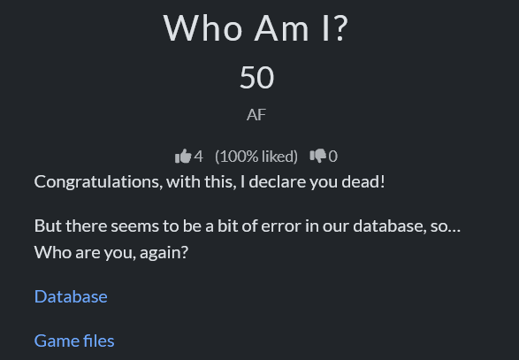
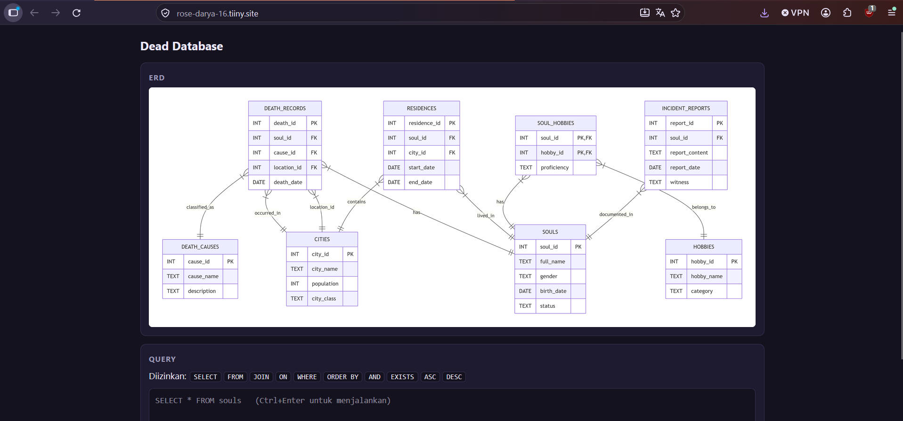
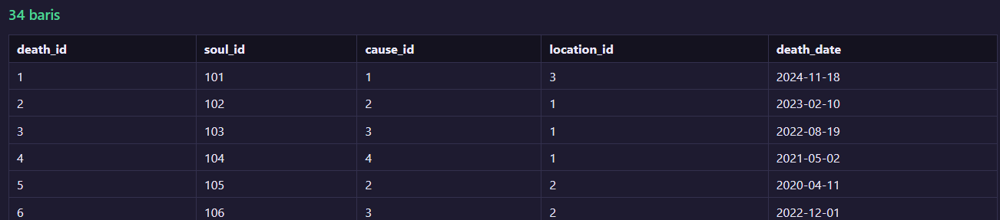
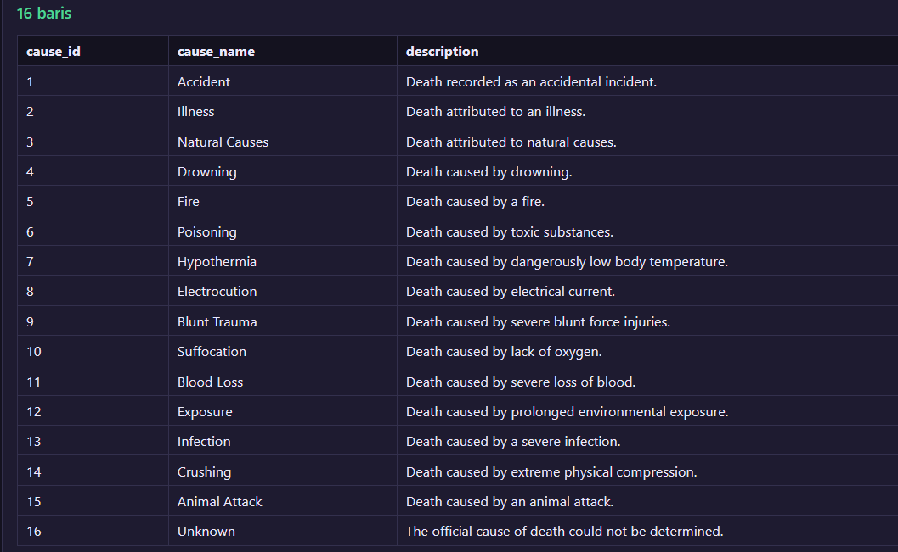
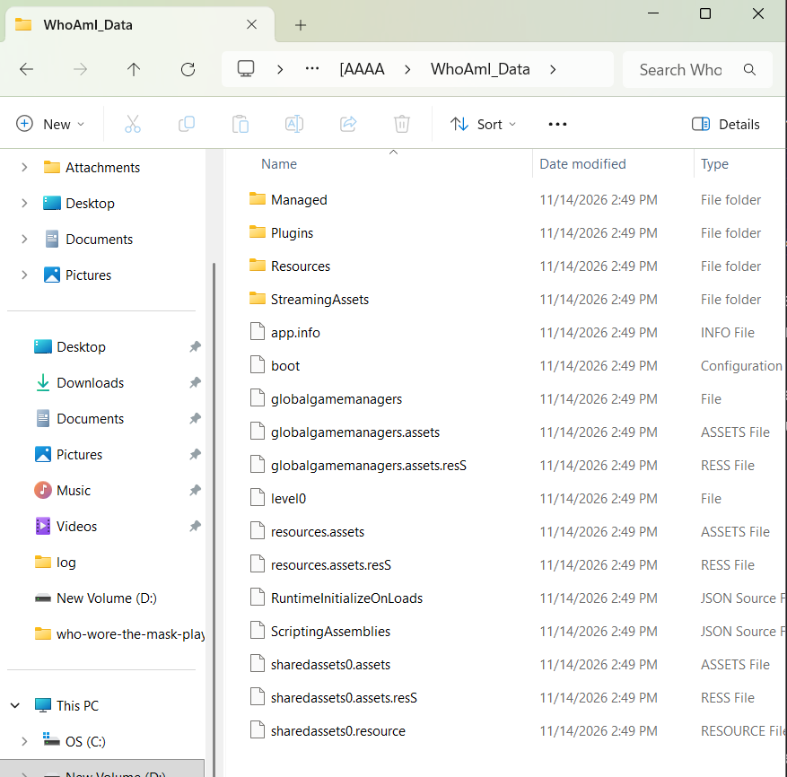
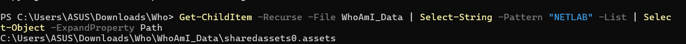
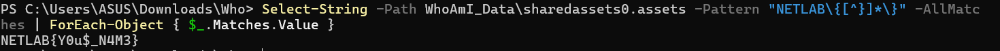

# Who Am I?

**Event:** NETLAB CTF · **Category:** Misc

### Challenge Description



### Walkthrough

I opened the database page first. its called "Dead Database" and it only has an ERD image and a query box. 


I tried running SELECT * FROM on every table and read everything. 34 souls in total (101 to 134).

Something is off in the data the description says there is "a bit of error in our database", so i looked for the one row that doesnt fit. for souls 102 to 134, the incident report always matches the cause of death. only soul 101 doesnt.
death_records says Elias Vane died from cause 1, which is Accident. but his incident_reports say there was a "bitter almond-like smell near the glass", a "strange residue at the bottom", and that the drink "tasted unusual" before he collapsed. that sounds like poison, not an accident.
checkpoint: Elias Vane (soul 101) is the wrong row. recorded as accident, but it looks like poisoning.



but the database never says who "you" are, so this was only a guess.
Going to the game files, i downloaded the whole drive folder. its a Unity game (WhoAmI.exe, UnityPlayer.dll, WhoAmI_Data/, MonoBleedingEdge/).
windows defender blocked WhoAmI.exe so i couldnt play it. i didnt really need to, because Unity games keep their text inside the data files and i can just read those. (not tryna bust my computer for ts)

inside WhoAmI_Data/ i noticed:
• level0, the only scene
• sharedassets0.assets, the biggest data file
• StreamingAssets/CS1.mp4, CS2.mp4, CS3.mp4, the cutscenes
• Managed/Assembly-CSharp.dll, the game's own code


Reading the files, i ran strings on each of them.
- in Assembly-CSharp.dll i saw Ketik jawabanmu... ("type your answer") and Jawaban salah... ("wrong answer"). so the game asks you to type something and checks it.
- in level0 i saw "It seems like you visit this place far too often, you forget..." and a "Type Your Answer Here" box.
- in sharedassets0.assets i found the whole script. it says "Well.. You can go check the database", so the database really is what we need. it also gives hints: "You used to live in a rather large city... It was too loud" and "Was it music? Gardening?".

Right in the middle of that dialogue there is a plain string:
Elias Vane
that is the answer to the name question, followed by "Ahh... That's true! Congratulation for finding out your name!"
checkpoint: the game's answer is Elias Vane, same as the odd row in the database.
the hints fit him too. in the database he lives in Meridian (a Large city) and his hobby is Violin (Music, Advanced). i didnt run a query to prove he is the only one that fits, but the name is literally in the game so i'm confident.
there is also a Reaper scene that asks "state how did you die" with options like "What actually killed me?". that matches the poisoning clue from step 2.

From here, i searched the whole game folder for the flag format:

only sharedassets0.assets matched. I found the flag in this file, right after the CS3 cutscene and right before the GreenHouse scene:
...CS3 ... Greeen ... NETLAB{Y0u$_N4M3} ... GreenHouse ...
so its the text you would see at the end of the game after answering the name and cause of death correctly.


### Flag

```
NETLAB{Y0u$_N4M3}
```
