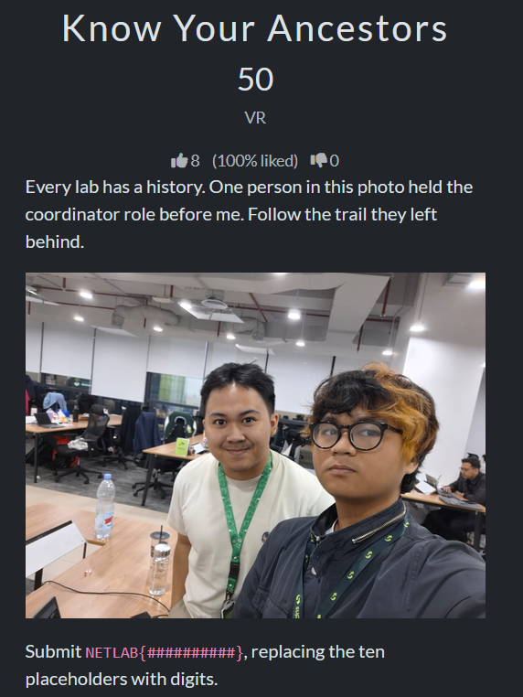
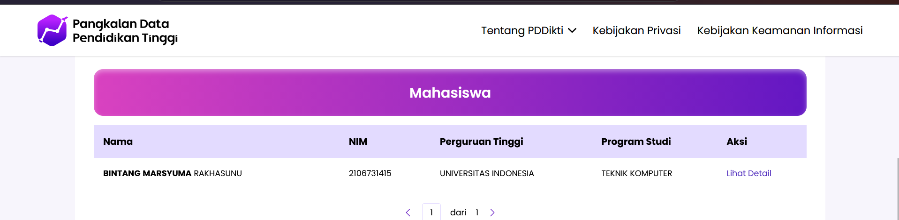

# Ancestors

**Event:** NETLAB CTF · **Category:** OSINT

### Challenge Description



### Walkthrough

I went circles going to linkedin, instagram, portfolios, github and explaining everything would be long af so straight to the point : 

I figured out that Bintang Marsyuma Rakhasunu is the coordinator for netlab in the previous year

I was wondering what clue would 10 digit means until i remember our NPMs are 10 digits so i searched for his NPM.

Hasil search di pdpt : 


I got 2106731415

added NETLAB, then submitted the flag
flag : NETLAB{2106731415}

### Flag

```
NETLAB{2106731415}
```
