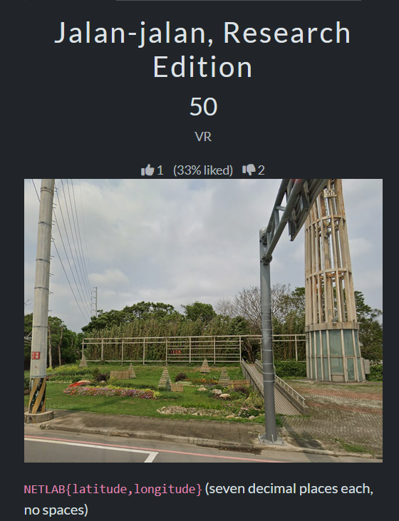
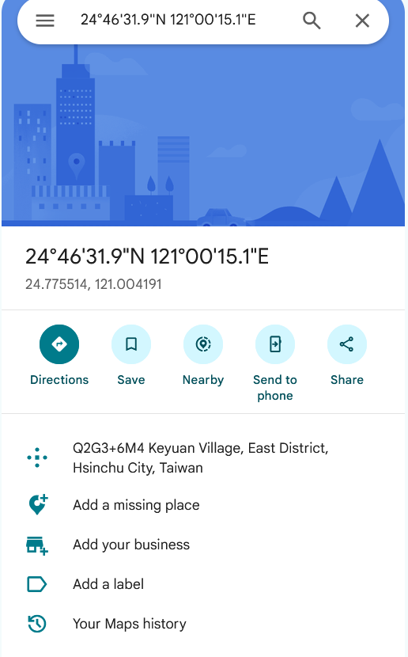

# Jalan-jalan, Research Edition

**Event:** NETLAB CTF · **Category:** OSINT

### Challenge Description



### Walkthrough

From the red box on the pole on the right side of the image, i knew that this is in taiwan, however finding out the specific place was hard.

I tried giving the image to multiple online 'picture founder' and nothing was sucsessful.

So i did abit of OSINT and decided that this place is something the author (bang alvin) is familiar with.

Asking some friends about this led me to WNC Corporation, a place the author had an internship in.

I looked around Hsinchu science park for awhile and didnt find any small park + clock tower from the sattelite.

So i went to Hsinchu city and found it. 



*i tried to show my gmaps screenshot but fuckass hackmd wont let me cause apparently its above 1MB

latitude : 24.775514
longitude : 121.004191

so the flag is : NETLAB{24.775514,121.004191}

### Flag

```
NETLAB{24.775514,121.004191}
```
