# Snivy Field Archive

**Event:** NETLAB CTF · **Category:** Web

### Walkthrough

I opened the site nothing jumped out in the rendered text, so I pulled the raw HTML instead of just reading what’s visible — and that’s where it got interesting.

There’s a < figure > tag wrapping the main Snivy image with some data attributes nobody would normally notice:
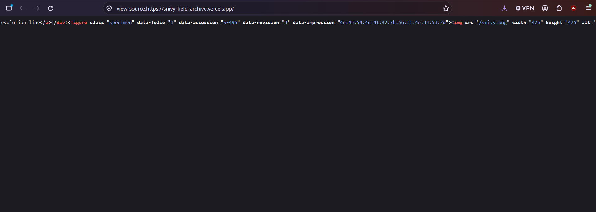

```html
<figure class="specimen" data-folio="1" data-accession="S-495" data-revision="3"
         data-impression="4e:45:54:4c:41:42:7b:56:31:4e:33:53:2d">
```

That data-impression is colon-separated hex byte pairs. Decoding it gave me : **NETLAB{V1N3S-**
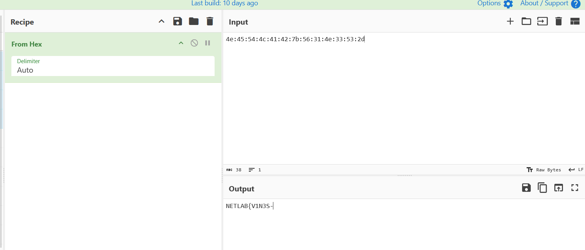
(i use cyberchef)

Further down the page, inside a collapsed < details > (“Earlier scans and comparison copies”), there were two more entries with the same accession S-495 but revision 2, and another with accession S-496. Each had its own data-impression hex blob too. So the trick is clear: not every impression on the page is correct — only one revision per accession is the “approved” one, and I need to figure out which.

Next I visited the archive page and found this table : 
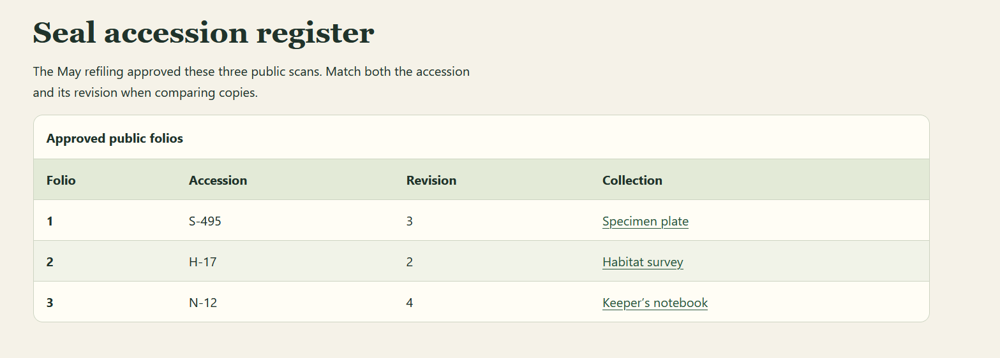

This told me exactly which (accession, revision) pair is the real one for each folio. Folio 1 = S-495 rev 3 — which matches the main figure I already decoded on the homepage (not the rev-2 decoy in the collapsed section).

Now I know I need to visit the Habitat page for H-17 rev 2, and the Field notes page for N-12 rev 4.

On habitat page, I found this part : 
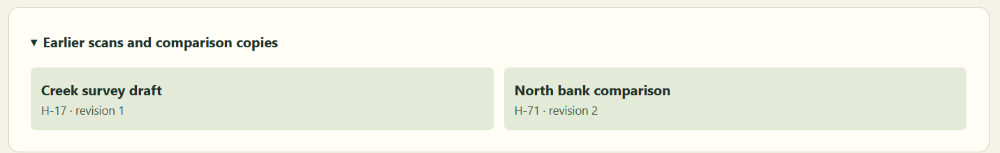

The archive page says “Match both the accession and its revision”. So i tried searching for both key words in the page source.
There are multiple entries for the key word but i need to find the one that associates with H-17 revision 2. Because the Seal accession register on archive page explicitly listed it as the approved folio 2 record
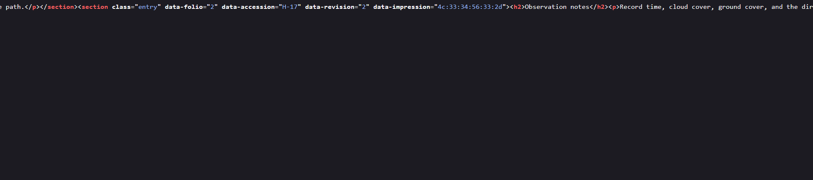

found 4c:33:34:56:33:2d

XOR it :  
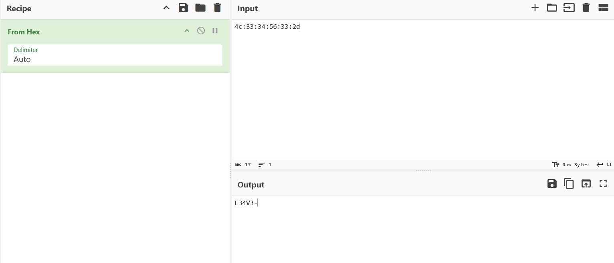
So piece 2 is **L34V3-**

Next, going to filed notes page, I found N-12 rev 3, N-12 rev 4, and a decoy N-21 rev 4 (same trick — right revision number, wrong accession). The register wants N-12 revision 4:
Doing the same thing again gave me 46:30:30:54:50:52:31:4e:54:53:2d and decoding it gave me **F00TPR1NTS-**

I found the next clue in the visible text of /field-notes/, in the “Keeper’s log” section:
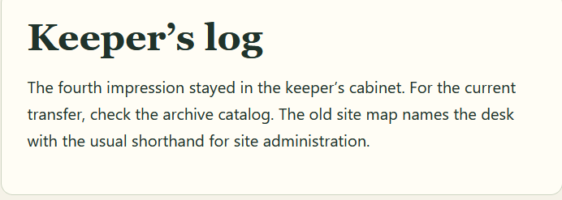

I read it as three instructions:
“Check the archive catalog”: go to /archive/. The table has a Status column, and exactly one conservation record is marked Current: K-12 “Seal cabinet transfer”.
“The desk”: K-12’s details list Site: Keeper’s desk.
“Usual shorthand for site administration”: admin. I tried /admin and it loaded.

/admin shows a “Keeper’s desk” page with one text box:
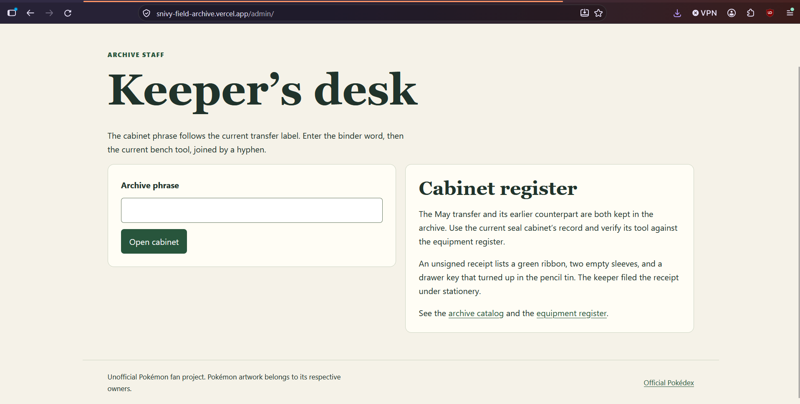
“Enter the binder word, then the current bench tool, joined by a hyphen.”

So the phrase is binderword-benchtool. I needed both words.

The binder word (from /archive/k-12)
Opening /archive/k-12,t he page says: “Consult the original label on this record for the binder word.”
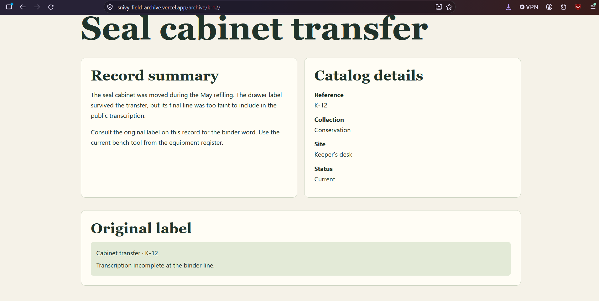

The label card at the bottom says “Transcription incomplete at the binder line”.
The K-12 page also says “Use the current bench tool from the equipment register”. The register is the table at the bottom of /care:
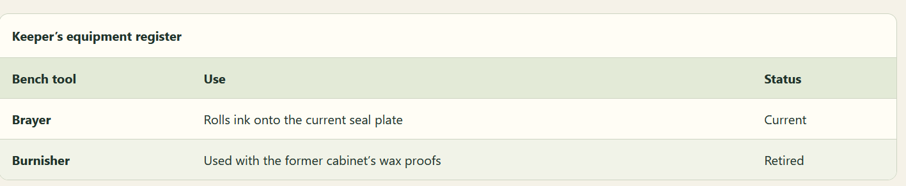
The current tool is Brayer.

Going to /admin, I tried typing linden-brayer into “Archive phrase”, and click Open cabinet : 
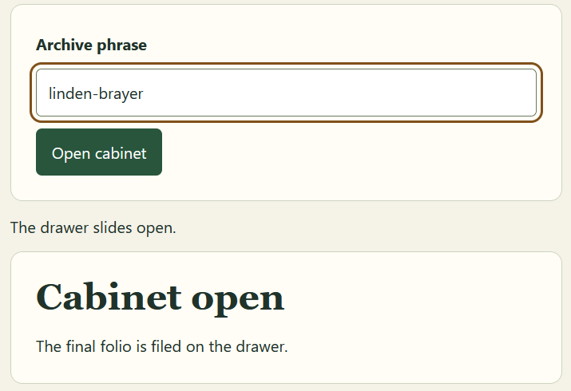

Its data-impression is 45:33:43:33:34:32:46:43:7d, which decodes to **E3C342FC}**.

Assembling all of them gets me : 

NETLAB{V1N3S-L34V3-F00TPR1NTS-E3C342FC}

### Flag

```
NETLAB{V1N3S-L34V3-F00TPR1NTS-E3C342FC}
```
