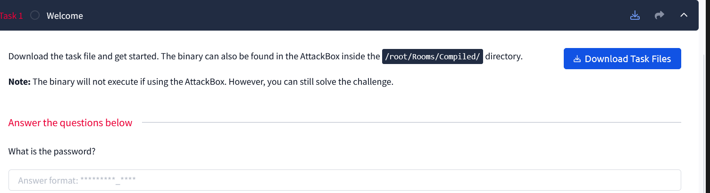
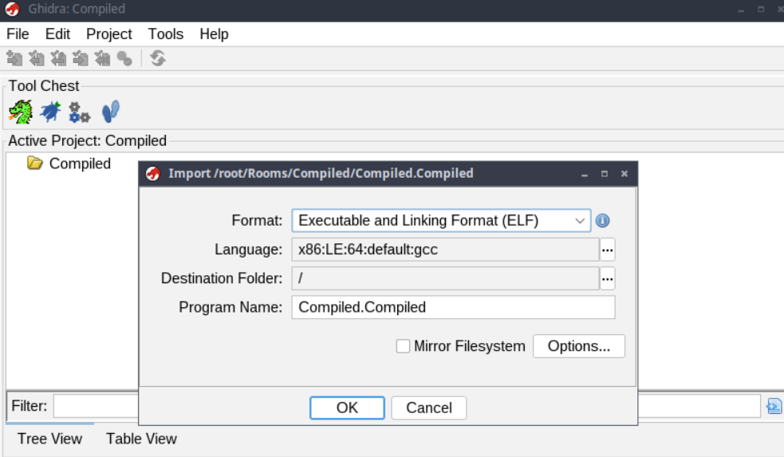
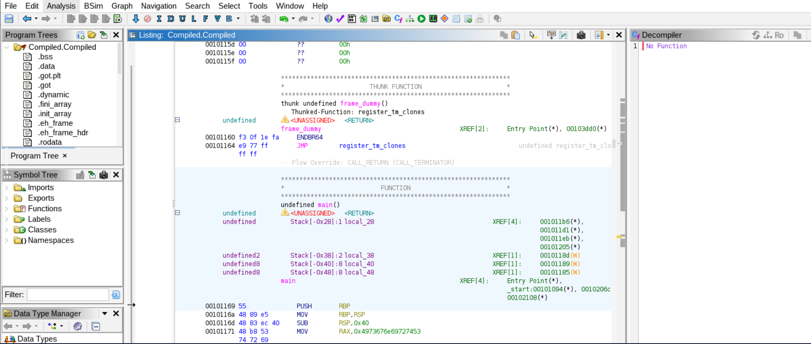
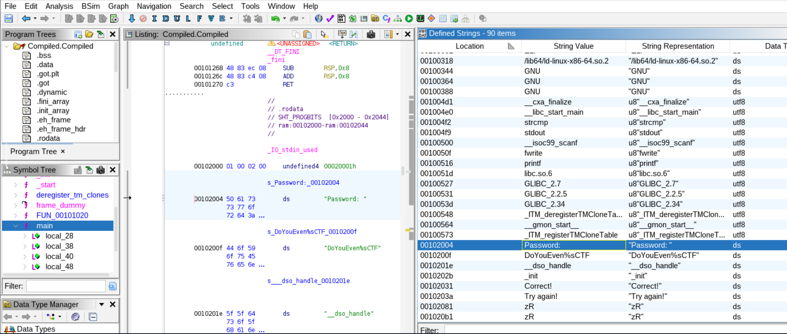
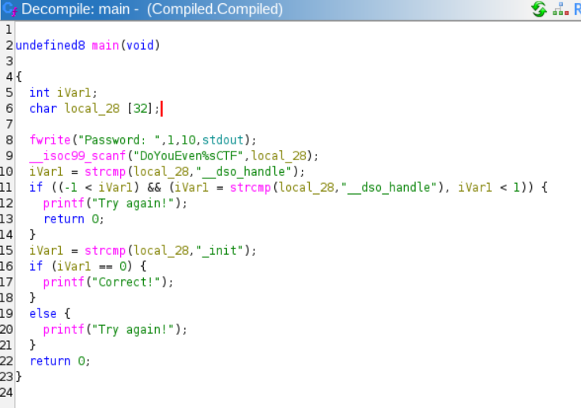

# THM Compiled Writeup

Binary analysis

go to the directory mentioned

open ghidra -> new project -> import file

after double clicking our file and selecting analyze now, we get this : 

go to functions and search for main, then go to windows -> defined strings to find some clues
here i find 'password'

but nothing came of it 

so i find something interesting in the decompile code for main

what this code does:

- Ask for password, receive it in format “DoYouEven%sCTF”, then store in variable ‘local_28’
- Compare the password string with “__dso_handle”, then store the result in ‘iVar1’
- If password strings equal to “__dso_handle”, it will print “Try again!” and end the program
- Compare the password string with “_init”, then store the result in ‘iVar1’
- If password strings equal to “_init”, means the password is correct.**

the important logic is:
__isoc99_scanf("DoYouEven%sCTF", local_28);
The input has to begin with:
DoyouEven
Then %s captures the next non-whitespace sequence into local_28.
And afterward:
strcmp(local_28, "_init")
requires:
local_28 == "_init"
So the intended input should indeed appear to be:
DoYouEven_init
