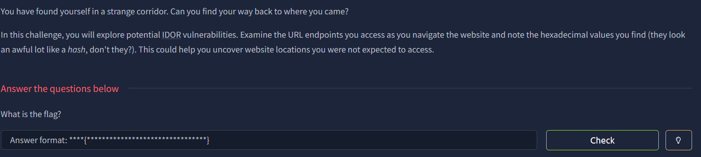
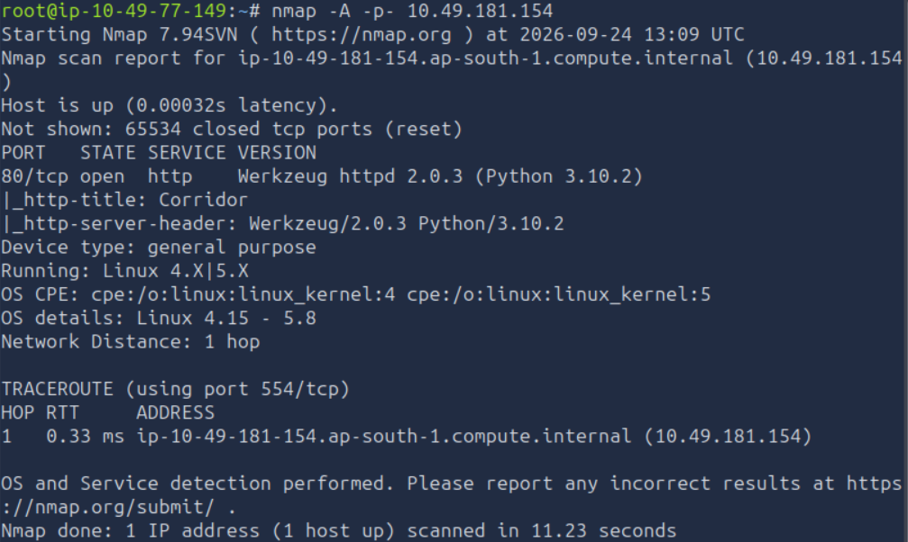
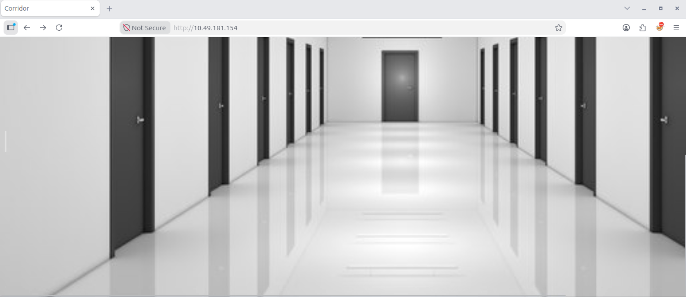
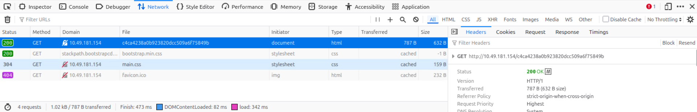
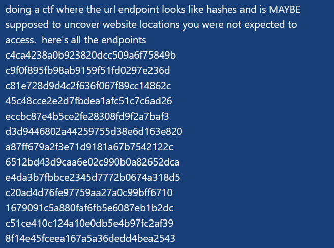

# THM Corridor Writeup

Forensics, hashing



run nmap

shows that only 1 port is up (80)

visit it

clicking on one of this doors broought me to an empty room

used inpsect -> network to see what's happening as i open a door

as expected, there's a sus lookin hash at the end of this url endpoint
at this point, i had the idea of collecting all these hashes and asking ai to crack them


so turns out, all those hashes just mean 1,2,3...,13.
they're all md5

i tried md5hashing 14 and putting it as the endpoint but it didnt work.

so i used this bash command to find a directory with a different size
```bash!
for i in {-100..100}; do
    hash=$(echo -n "$i" | md5sum | cut -d' ' -f1)
    code=$(curl -s -o /tmp/resp -w "%{http_code}" "http://IP/$hash")
    size=$(wc -c < /tmp/resp)
    echo "$i -> $code -> $size bytes"
done
```

found md5'd 0 interesting as the byte size is different

used curl to get the flag
