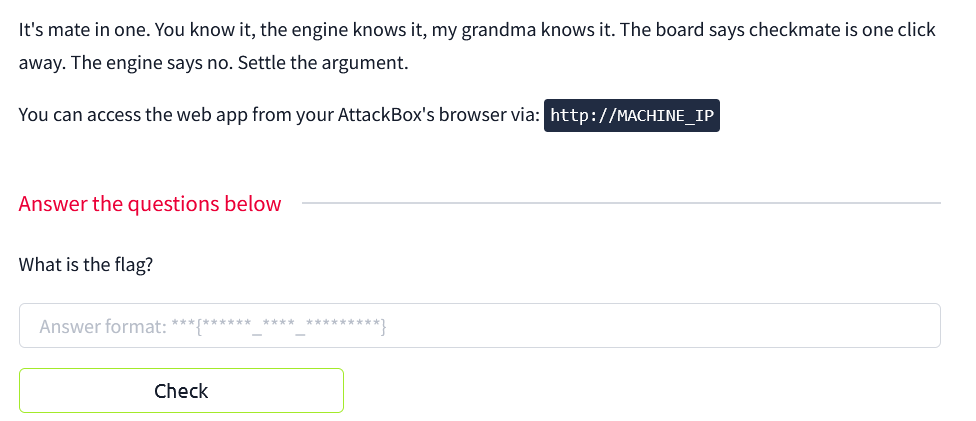
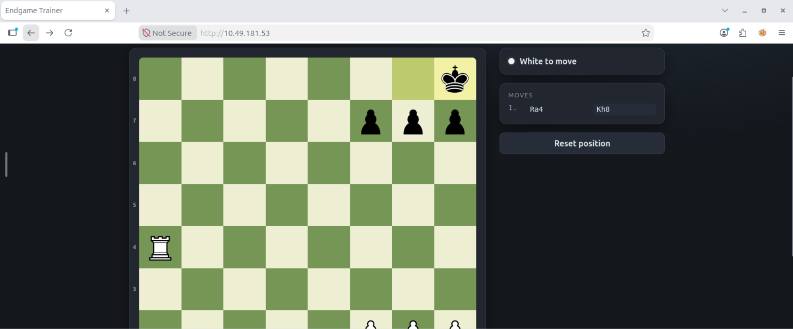
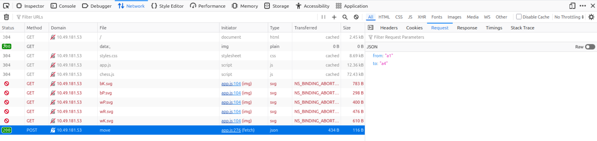
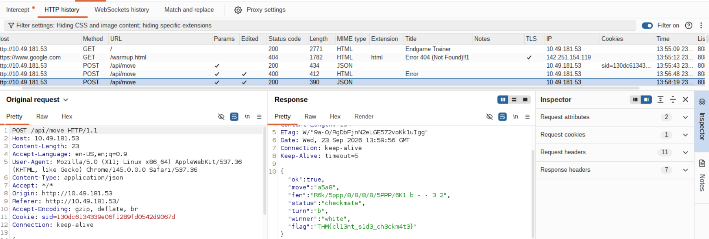

# THM Fools Mate Writeup

WebEx, client-side validation bypass

was met with a web that didnt allow me to mate 

inspected the source code and didnt find anything interesting

i opened inspect -> network to see what would happen when i try mating the black king and nothing popped up.

next thing i tried is moving my rook to a normal place like a4 and got the required variable

pay attention to from and to

from here, i got an idea to change the variable 'to' to a8 (mate) using burp suite proxy feature
turned on intercept -> edited 'to' from a4 to a8, checked the result in http history

then got the flag

Lesson : 
- always check parameters using inspect -> network to find anything interesting
- burp suite is sexy af ngl
